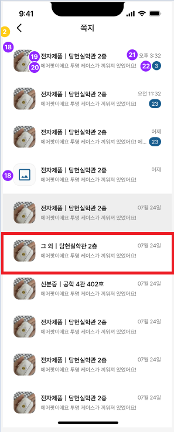
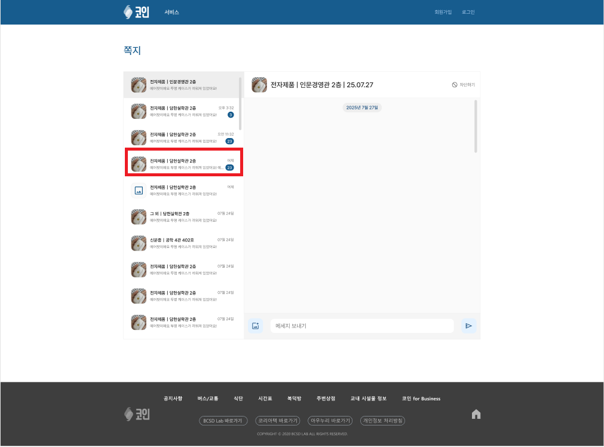
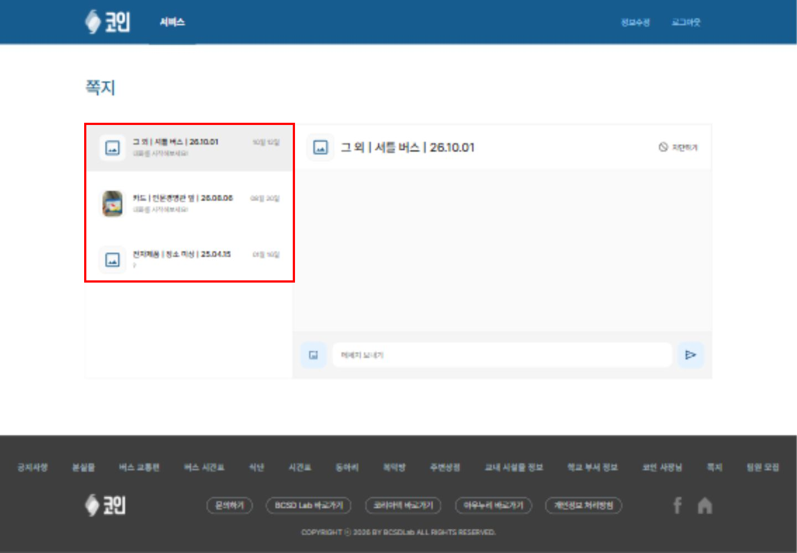
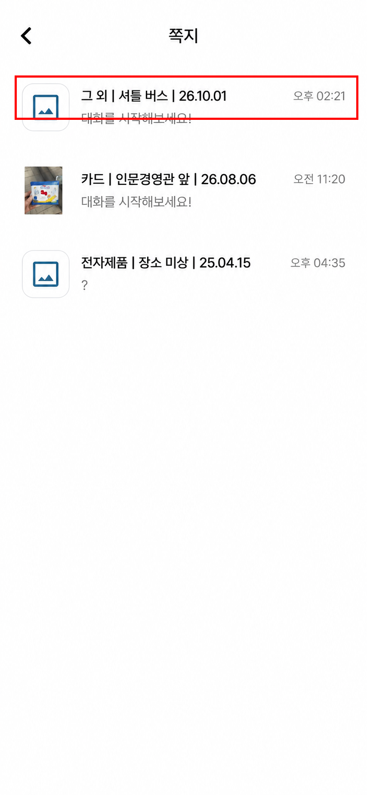

# 11-16.쪽지리스트_대화창_클릭

[← 게시판 로깅 목록](README.md)

플랫폼: ANDROID · IOS · WEB  
원문 상태: 완료

과거 로깅·새 로깅과 각 참고사진은 원문의 구간별 연결을 유지합니다.

<!-- logging-section:past:start -->
## 과거 로깅

- 설명:  쪽지 리스트에서 특정 대화창을 클릭
- event\_label : “message\_list\_select”
- value : “쪽지”
- event\_category : “click”
- 참고사진

Mobile, Mobile\_Web\_VIEW

WEB

<!-- logging-section:past:end -->

<!-- logging-section:new:start -->
## 새 로깅

- 설명: 쪽지 목록의 대화 항목을 클릭해 해당 대화를 선택할 때 기록한다. WEB의 통합 화면 안 목록 영역도 같은 논리 화면으로 취급한다.
- screen\_view: <code>chat_list</code>
- event\_label: <code>chat__chat_list__chat_conversation__entry__click</code>
- event\_name: <code>DA2</code>
- value: 쪽지
- event\_category: <code>click</code>

### 참고사진 (기능 표시)

<b>웹(데스크톱)</b>

<b>참고사진 · 웹</b>

실제 데스크톱 WEB 캡처(2026-10-16). 빨간 박스는 대화 항목 클릭 영역이다. 목록과 대화는 한 화면에 있고, 대화 선택은 query만 변경하므로 screen\_view는 chat을 유지한다.

<b>모바일 (ANDROID, IOS) / 캡처 출처는 아래 참조</b>

<b>참고사진 · 모바일</b>

화면 정의의 Android 실제 캡처(2026-10-13), 선명도 개선본. 이번 작업은 기존 캡처를 사용.

<!-- logging-section:new:end -->

---

원문 정보

원본 ID: `d830221954bc82c6a9cb01cafff6884f`  
[보존 원문](../../_archive/original/notion/pages/d830221954bc82c6a9cb01cafff6884f.md)

