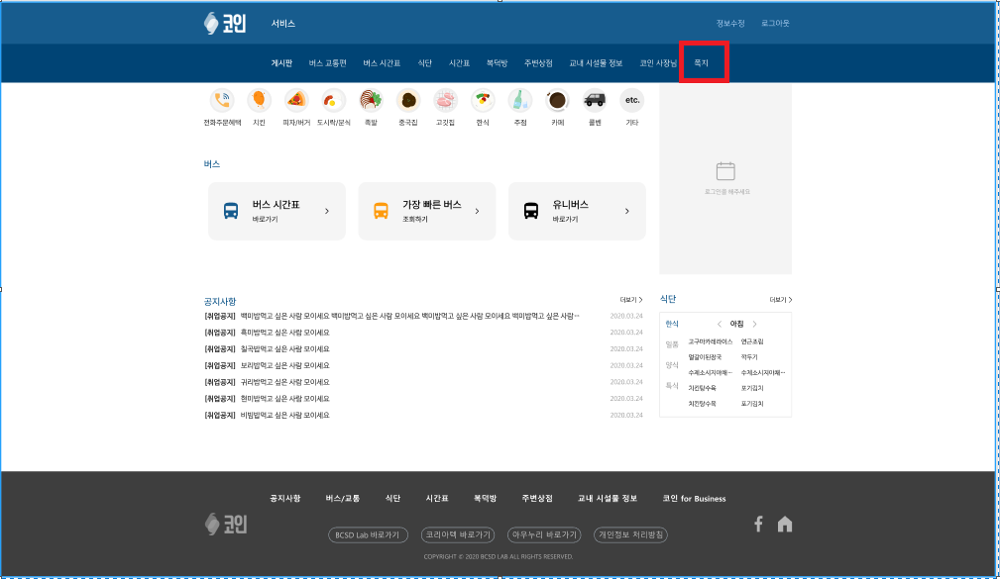

# 11-17.헤더_쪽지_클릭

[← 게시판 로깅 목록](README.md)

플랫폼: WEB  
원문 상태: 완료

과거 로깅·새 로깅과 각 참고사진은 원문의 구간별 연결을 유지합니다.

<!-- logging-section:past:start -->
## 과거 로깅

- 설명:  웹 페이지 헤더 에서 쪽지 버튼 클릭
- event\_label : “header”
- value : “쪽지”
- event\_category : “click”

WEB

<!-- logging-section:past:end -->

<!-- logging-section:new:start -->
## 새 로깅

- 구체적 발생 조건: 웹의 공용 영역에서 상단 서비스 메뉴를 열고 ‘쪽지’를 클릭한다.
- screen\_view: <code>header</code>
- event\_label: <code>chat__header__chat_entry__header_entry__click</code>
- event\_name: <code>DA2</code>
- event\_category: <code>click</code>
- value: 쪽지

### 참고사진 (커뮤니티 → 쪽지 · WEB 리디자인)

#### 웹

커뮤니티 → 쪽지. 출처: [Figma WEB 리디자인](https://www.figma.com/design/DPlcYuiFxhyT5ULbqec59i/KOIN-Web?node-id=11541-33352), 2026-11-04 원본 캡처에 코드로 빨간 네모만 추가. 빨간 네모는 기존 명세가 지칭하는 클릭 대상이다. 실제 클릭 가능 여부·SDK 적용·배포·수집은 미확인이다.

<!-- logging-section:new:end -->

---

원문 정보

원본 ID: `6610221954bc83c794e60155ecc5d6fc`  
[보존 원문](../../_archive/original/notion/pages/6610221954bc83c794e60155ecc5d6fc.md)

