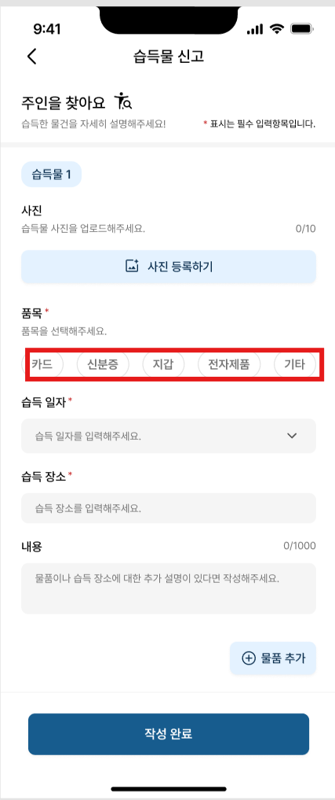
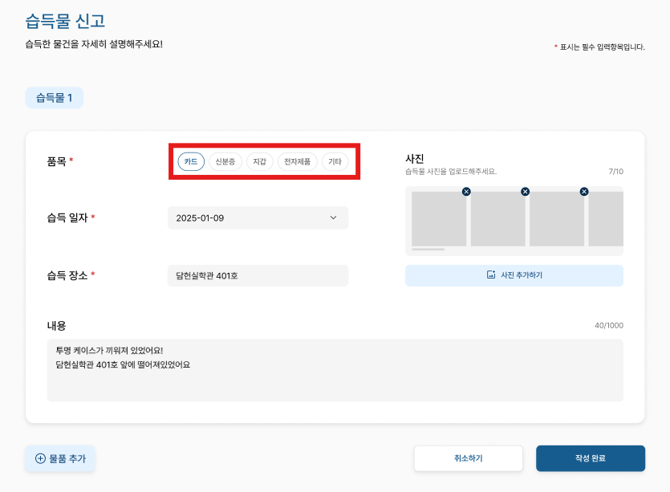
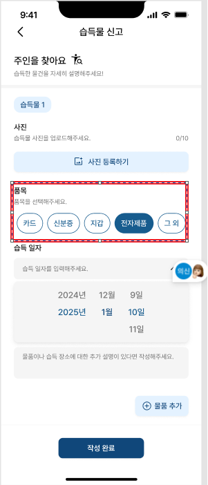
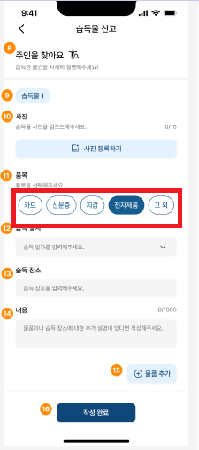
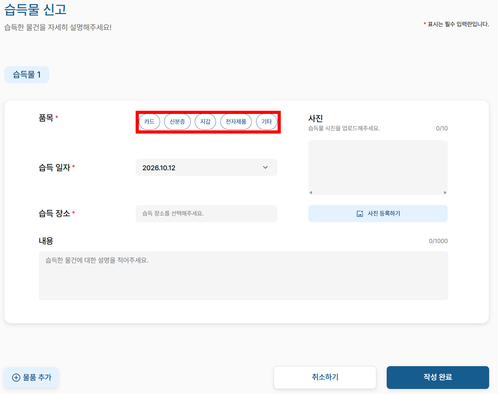
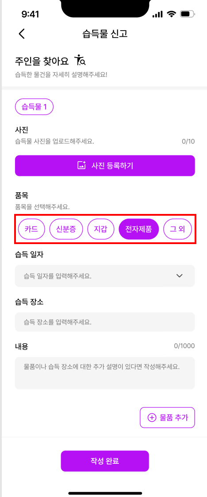

# 11-2.분실물_습득물신고_품목선택_클릭

[← 게시판 목록](README.md)

플랫폼: ANDROID, IOS, WEB  
원문 상태: 완료  
[Notion 기준 명세](https://app.notion.com/p/3940221954bc8363a3b88195b31f60ba)  
원본 ID: `3940221954bc8363a3b88195b31f60ba`

<!-- notion-body:start -->
## 과거 로깅

- 설명: 습득물 신고 글쓰기 페이지에서 ‘품목을 선택해주세요.’ 버튼을 클릭하여 품목을 선택
- event\_label : “find\_user\_category”
- value : \{”카드”, ”신분증”, ”지갑”, ”전자제품”, ”<s>그 외</s>”\} 5가지 값을 추가
- → “그 외”를 “기타”로 변경(2025-02-23)
- event\_category : “click”
- 참고사진





<b>이전 참고사진</b>




WEB Mobile View



## 새 로깅

- 설명: 습득물 신고 글쓰기 화면에서 품목을 선택.
- screen\_view: <code>found_item_write</code>
- event\_name: <code>DA2</code>
- event\_label: <code>board__found_item_write__lost_item_write__item_category__select</code>
- value: <code>{실제 선택한 품목명}</code> — 동적 STRING. 선택 당시 UI의 항목 표시값을 매핑한다. 그 외·기타 등 표시 문구를 임의의 고정 목록으로 치환하지 않는다.
- event\_category: <code>select</code>
- 발생 시점 (2026-10-16 확정): 실제 품목 항목을 선택하는 순간 전송한다. 품목 선택창을 여는 클릭이나 글 작성완료까지 기다리지 않는다.

### 참고사진 (기능 표시)

<b>웹</b>

<b>참고사진 · 웹</b>

웹 — 습득물 품목 선택



<b>모바일</b>

<b>참고사진 · 모바일</b>

모바일 — 습득물 품목 선택


<!-- notion-body:end -->

<details>
<summary>Notion 원문 속성 전체</summary>

```json
{
  "platform": [
    "ANDROID",
    "IOS",
    "WEB"
  ],
  "url": "https://app.notion.com/p/3940221954bc8363a3b88195b31f60ba",
  "상태": "완료",
  "이름": "11-2.분실물\\_습득물신고\\_품목선택\\_클릭",
  "태그": [
    "11.분실물"
  ]
}
```

</details>
