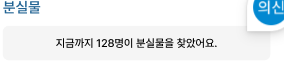
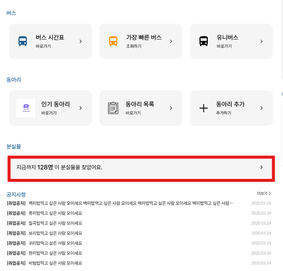
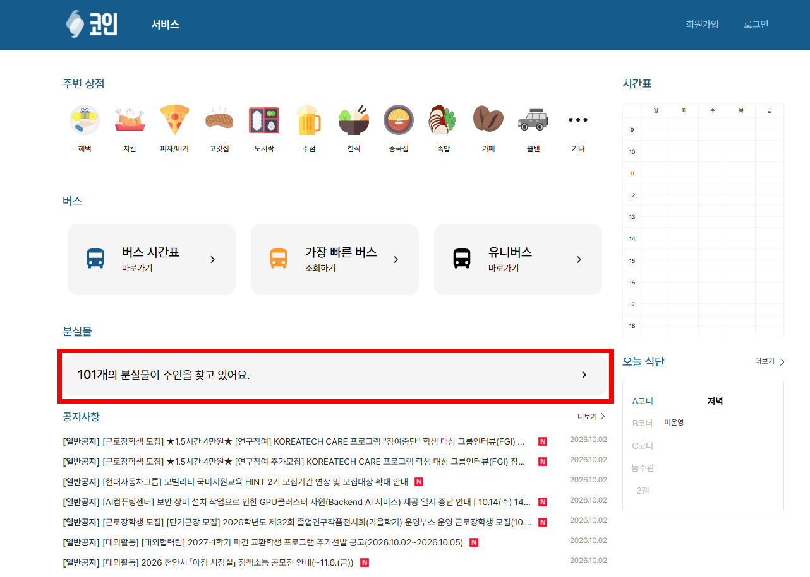

# 11-20.분실물_메인진입_클릭

[← 게시판 로깅 목록](README.md)

플랫폼: WEB  
원문 상태: 완료

과거 로깅·새 로깅과 각 참고사진은 원문의 구간별 연결을 유지합니다.

<!-- logging-section:past:start -->
## 과거 로깅

- 설명: 메인화면에서 분실물로 진입하는 이벤트
- event\_label : lost\_item\_entry
- value : 분실물
- event\_category : click

<!-- logging-section:past:end -->

<!-- logging-section:new:start -->
## 새 로깅

- 설명: 메인화면에서 분실물로 진입하는 이벤트
- screen\_view: <code>main</code>
- event\_name: <code>DA2</code>
- event\_label: <code>board__main__lost_item_entry__main_entry__click</code>
- value: 분실물
- event\_category: <code>click</code>

<b>참고사진 (기능 표시)</b>

<b>웹</b>

웹 — 메인 분실물 진입

<b>모바일</b>

모바일 웹 — 메인 분실물 진입 (기존 로깅 캡처)

- 사진 기준: 모바일 사진은 기존 모바일 웹 메인 캡처입니다. 앱의 카테고리 화면 진입은 11-21에서 별도로 표시합니다.

<!-- logging-section:new:end -->

---

원문 정보

원본 ID: `6c30221954bc82f98d29015150c37e2c`  
[보존 원문](../../_archive/original/notion/pages/6c30221954bc82f98d29015150c37e2c.md)

