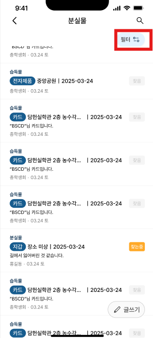
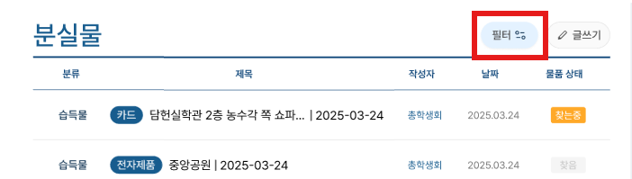
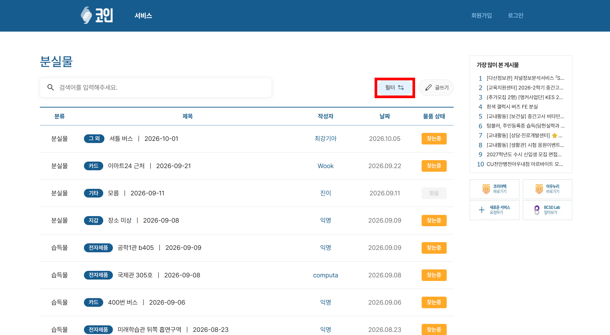
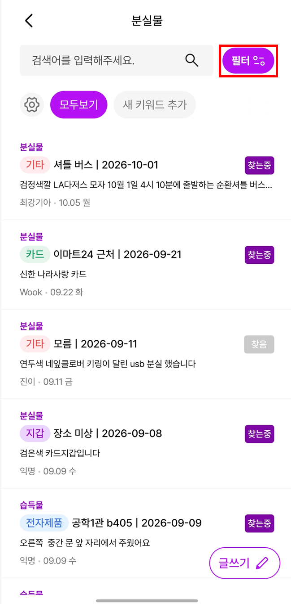

# 11-22. 분실물_필터_클릭

[← 게시판 로깅 목록](README.md)

플랫폼: ANDROID · IOS · WEB  
원문 상태: 완료

과거 로깅·새 로깅과 각 참고사진은 원문의 구간별 연결을 유지합니다.

<!-- logging-section:past:start -->
## 과거 로깅

- 설명: 분실물 글 목록 페이지에서 필터 버튼 클릭
- event\_label : lost\_item\_filter
- value : 분실물
- event\_category : click

<!-- logging-section:past:end -->

<!-- logging-section:new:start -->
## 새 로깅

- 설명: 분실물 글 목록 페이지에서 필터 버튼 클릭
- screen\_view: <code>lost_item_list</code>
- event\_name: <code>DA2</code>
- event\_label: <code>board__lost_item_list__filter__open__click</code>
- value: 분실물
- event\_category: <code>click</code>

### 참고사진 (기능 표시)

#### 웹

웹 — 필터 열기

#### 모바일

모바일 — 필터 열기

<!-- logging-section:new:end -->

---

원문 정보

원본 ID: `e3d0221954bc82b8a151813ce8f00019`  
[보존 원문](../../_archive/original/notion/pages/e3d0221954bc82b8a151813ce8f00019.md)

