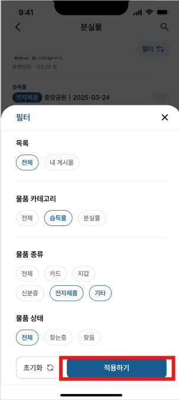
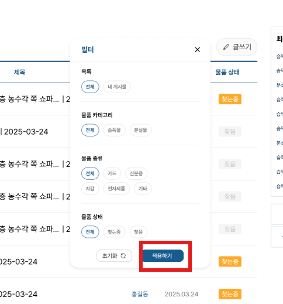
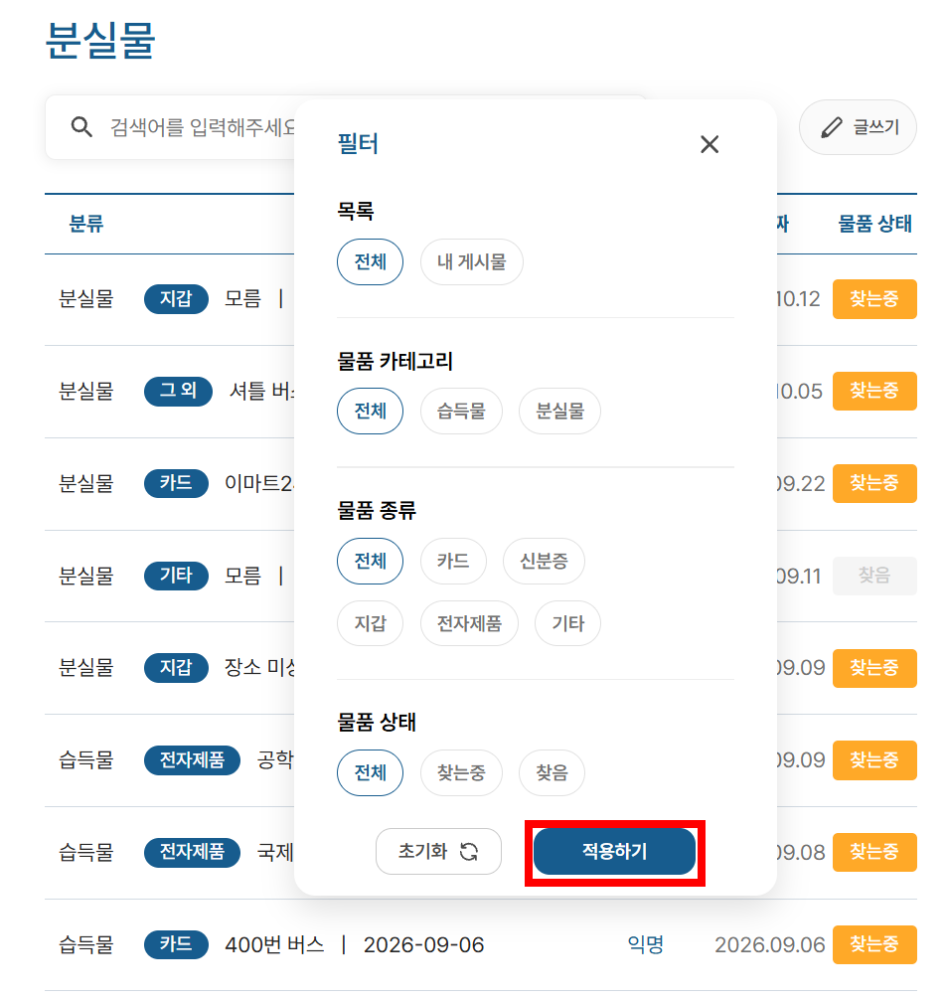
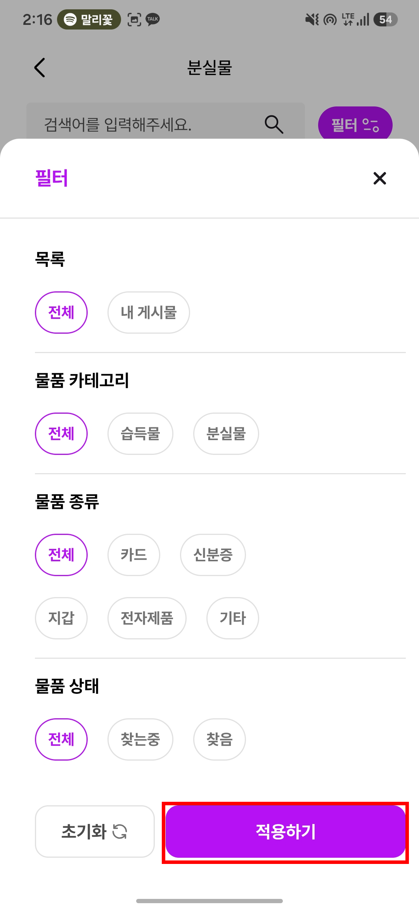

# 11-23. 분실물_필터_적용_클릭

[← 게시판 목록](README.md)

플랫폼: ANDROID, IOS, WEB  
원문 상태: 완료  
[Notion 기준 명세](https://app.notion.com/p/1010221954bc838dac6f01b0100de935)  
원본 ID: `1010221954bc838dac6f01b0100de935`

<!-- notion-body:start -->
## 과거 로깅

- 설명: 필터 화면에서 적용하기 버튼 클릭
- event\_label : lost\_item\_filter\_apply
- value : 분실물
- event\_category : click
- 참고사진





## 새 로깅

- 설명: 필터 화면에서 적용하기 버튼 클릭
- screen\_view: <code>lost_item_list</code>
- event\_name: <code>DA2</code>
- event\_label: <code>board__lost_item_list__filter__apply__click</code>
- value: 분실물
- event\_category: <code>click</code>
- 전송 구조: 기존 value ‘분실물’은 공통 식별값으로 유지한다. 최종 필터 값은 아래 네 개의 별도 STRING 파라미터로 보낸다. 하나의 JSON·리스트 문자열로 합치지 않는다.

<table fit-page-width="true" header-row="true">
<tr>
<td>
파라미터
</td>
<td>
그룹
</td>
<td>
전송 값
</td>
</tr>
<tr>
<td>
<code>filter_scope</code>
</td>
<td>
목록
</td>
<td>
전체 / 내 게시물
</td>
</tr>
<tr>
<td>
<code>filter_post_type</code>
</td>
<td>
물품 카테고리
</td>
<td>
전체 / 습득물 / 분실물
</td>
</tr>
<tr>
<td>
<code>filter_item_type</code>
</td>
<td>
물품 종류
</td>
<td>
전체 / 카드 / 신분증 / 지갑 / 전자제품 / 기타. 복수 예: 카드\|지갑
</td>
</tr>
<tr>
<td>
<code>filter_status</code>
</td>
<td>
물품 상태
</td>
<td>
전체 / 찾는중 / 찾음
</td>
</tr>
</table>

- 공통 규칙: 매 적용 클릭마다 네 키를 모두 보낸다. 기본·전체 상태는 ‘전체’로 쓰고 키를 생략하지 않는다. 단일 선택은 해당 한국어 값 하나, UI가 허용하는 복수 선택은 중복 제거 후 정의된 UI 순서로 ‘\|’ 연결한다. 전체와 개별 값을 함께 넣지 않는다. 단일 선택 UI를 복수 선택으로 바꾸는 요구는 아니다.
- 예시: filter\_scope=‘전체’, filter\_post\_type=‘습득물’, filter\_item\_type=‘카드\|지갑’, filter\_status=‘찾는중’.
- 발생 범위: 필터 열기 11-22는 유지한다. 적용하지 않고 닫는 경우에는 이 적용 이벤트를 보내지 않는다. screen\_view는 lost\_item\_list이며, 모달 이름으로 바꾸지 않는다.

### 참고사진 (기능 표시)

<b>웹</b>

<b>참고사진 · 웹</b>

웹 — 필터 적용하기



<b>모바일</b>

<b>참고사진 · 모바일</b>

모바일 — 필터 적용하기


<!-- notion-body:end -->

<details>
<summary>Notion 원문 속성 전체</summary>

```json
{
  "platform": [
    "ANDROID",
    "IOS",
    "WEB"
  ],
  "url": "https://app.notion.com/p/1010221954bc838dac6f01b0100de935",
  "상태": "완료",
  "이름": "11-23. 분실물\\_필터\\_적용\\_클릭",
  "태그": [
    "11.분실물"
  ]
}
```

</details>
