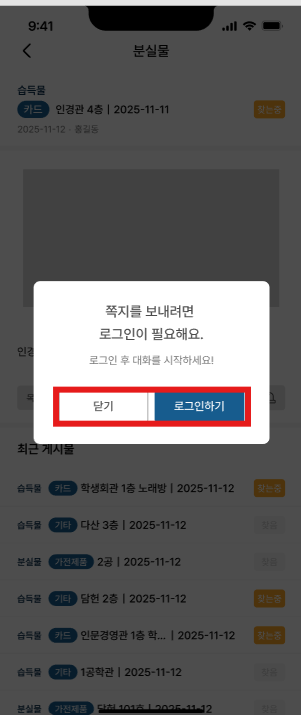
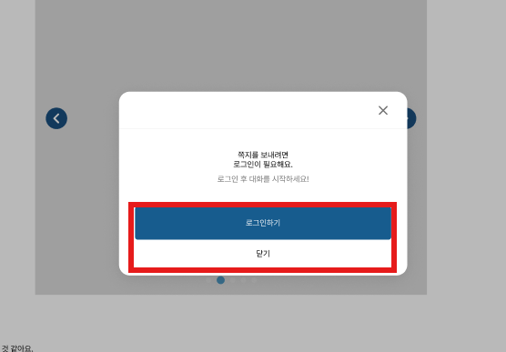
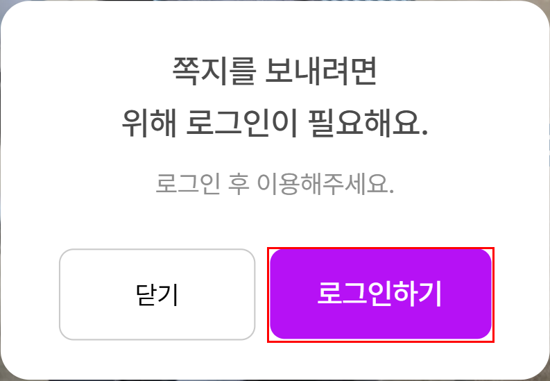

# 11-25. 분실물_쪽지_로그인요청_클릭

[← 게시판 로깅 목록](README.md)

플랫폼: ANDROID · IOS · WEB  
원문 상태: 완료

과거 로깅·새 로깅과 각 참고사진은 원문의 구간별 연결을 유지합니다.

<!-- logging-section:past:start -->
## 과거 로깅

- 설명: 로그인 요청 모달에서 ‘닫기’ 혹은 ‘로그인하기’ 버튼 중 클릭하는 버튼에 따라 ‘value’를 달리 해주시면 될 것 같습니다
- event\_label : lost\_item\_message\_login\_request
- value : ‘닫기’ or ‘로그인하기’
- event\_category : click

<!-- logging-section:past:end -->

<!-- logging-section:new:start -->
## 새 로깅

- 설명: 쪽지 보내기에서 표시된 로그인 요청 팝업의 닫기 또는 로그인하기 버튼을 클릭.
- screen\_view: <code>lost_item_detail</code>
- event\_name: <code>DA2</code>
- event\_label:
  - 로그인하기 응답: <code>account__lost_item_detail__login_popup__login_entry__click</code>
  - 닫기 응답: <code>account__lost_item_detail__login_popup__close__click</code>
- value: 닫기 / 로그인하기
- event\_category: <code>click</code>

### 참고사진 (기능 표시)

#### 웹

웹 — 쪽지 로그인 요청의 로그인하기·닫기 (기존 로깅 캡처)

#### 모바일

모바일 웹 · 실제 운영 분실물에서 쪽지 보내기를 눌러 열린 보라색 로그인 안내. 빨간 테두리=로그인하기. 게시물의 이름·사진·본문이 포함되지 않도록 안내창 부분만 실제 캡처했다. 실제 표시 문구를 수정하지 않았다. 네이티브 앱·SDK 검증과 구분.

모바일 — 쪽지 로그인 요청의 로그인하기·닫기 (기존 로깅 캡처)

구버전 사진을 제거하고 현재 보라색 모바일 웹의 실제 쪽지 로그인 안내로 보완했다.

<!-- logging-section:new:end -->

---

원문 정보

원본 ID: `d2a0221954bc83d48c9081b93bc2a6a1`  
[보존 원문](../../_archive/original/notion/pages/d2a0221954bc83d48c9081b93bc2a6a1.md)

