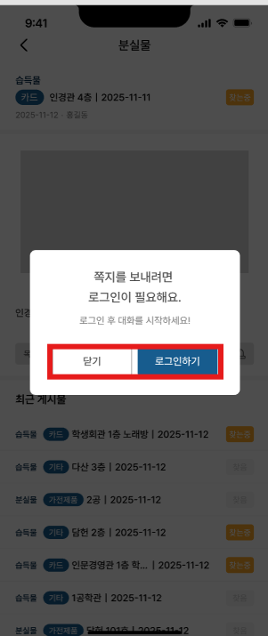
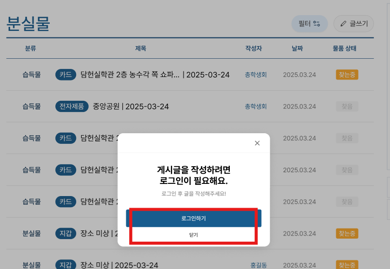
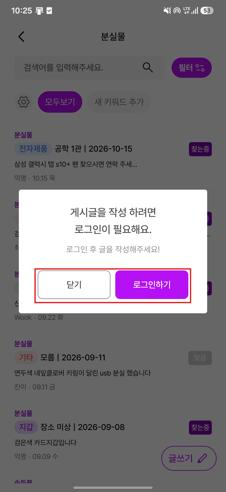

# 11-26. 분실물_글쓰기_로그인요청_클릭

[← 게시판 목록](README.md)

플랫폼: ANDROID, IOS, WEB  
원문 상태: 완료  
[Notion 기준 명세](https://app.notion.com/p/64c0221954bc837b93ac817502e4bd5a)  
원본 ID: `64c0221954bc837b93ac817502e4bd5a`

<!-- notion-body:start -->
## 과거 로깅

- 설명: 로그인 요청 모달에서 ‘닫기’ 혹은 ‘로그인하기’ 버튼 중 클릭하는 버튼에 따라 ‘value’를 달리 해주시면 될 것 같습니다
- event\_label : lost\_item\_write\_login\_request
- value : ‘닫기’ or ‘로그인하기’
- event\_category : click
- 참고사진





## 새 로깅

- 설명: 글쓰기에서 표시된 로그인 요청 팝업의 닫기 또는 로그인하기 버튼을 클릭.
- screen\_view: <code>lost_item_list</code>
- event\_name: <code>DA2</code>
- event\_label:
  - 로그인하기 응답: <code>account__lost_item_list__login_popup__login_entry__click</code>
  - 닫기 응답: <code>account__lost_item_list__login_popup__close__click</code>
- value: 닫기 / 로그인하기
- event\_category: <code>click</code>

### 참고사진 (기능 표시)

<b>웹</b>

<b>참고사진 · 웹</b>

웹 — 글쓰기 로그인 요청의 로그인하기·닫기 (기존 로깅 캡처)


<b>모바일</b>

<b>참고사진 · 모바일</b>

모바일 — 글쓰기 로그인 요청. 2026-10-16 사용자가 현재 버전 캡처로 수정 완료한 사진을 유지한다.


<!-- notion-body:end -->

<details>
<summary>Notion 원문 속성 전체</summary>

```json
{
  "platform": [
    "ANDROID",
    "IOS",
    "WEB"
  ],
  "url": "https://app.notion.com/p/64c0221954bc837b93ac817502e4bd5a",
  "상태": "완료",
  "이름": "11-26. 분실물\\_글쓰기\\_로그인요청\\_클릭",
  "태그": [
    "11.분실물"
  ]
}
```

</details>
