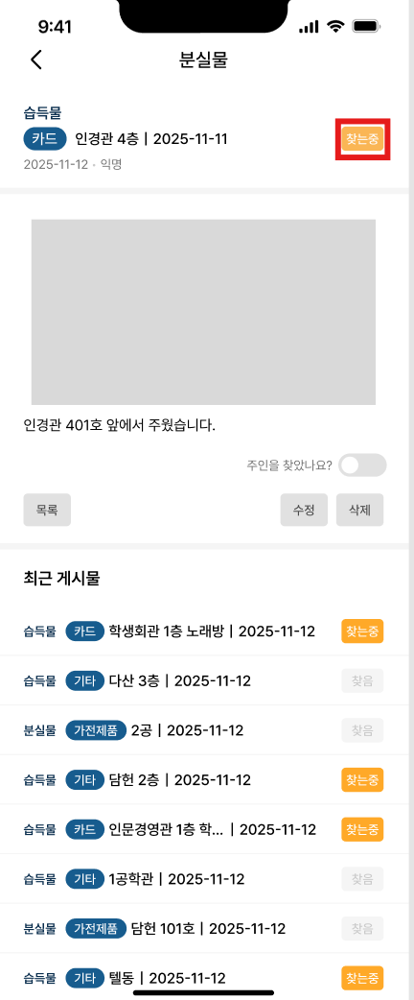
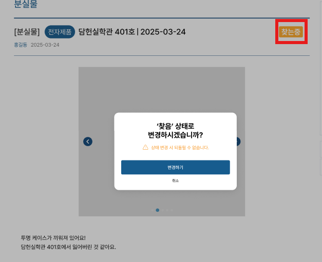
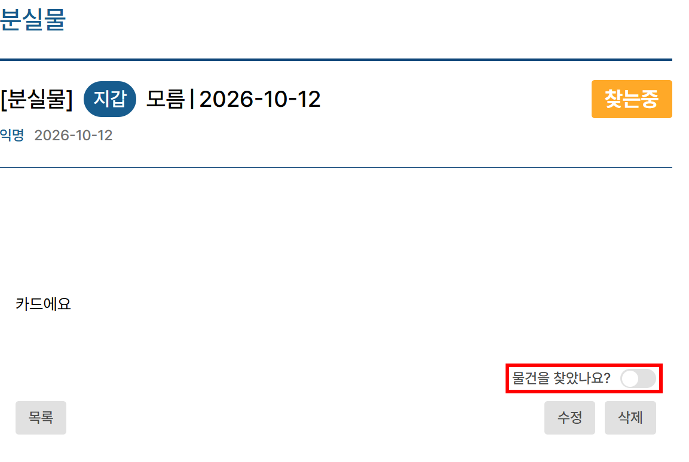
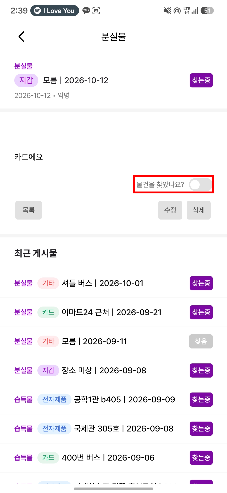

# 11-27. 분실물_상태변경_클릭

[← 게시판 로깅 목록](README.md)

플랫폼: ANDROID · IOS · WEB  
원문 상태: 완료

과거 로깅·새 로깅과 각 참고사진은 원문의 구간별 연결을 유지합니다.

<!-- logging-section:past:start -->
## 과거 로깅

- 설명: 분실물 글에서 상태변경을 위해 ‘찾는중’ 버튼을 눌렀을 때 이벤트입니다. 게시글 종류에 따라 value를 따로 넣어주시면 감사하겠습니다
- event\_label : lost\_item\_state\_change
- value : ‘습득물’ or ‘분실물’
- event\_category : click
- 참고사진

<!-- logging-section:past:end -->

<!-- logging-section:new:start -->
## 새 로깅

- 설명: 본인 게시물 상세에서 상태 변경 컨트롤을 조작해 확인 모달을 여는 순간 전송한다.
- screen\_view: <code>lost_item_detail</code>
- event\_name: <code>DA2</code>
- event\_label: <code>board__lost_item_detail__lost_item_status__open__click</code>
- value: 분실물 / 습득물
- event\_category: <code>click</code>

### 참고사진 (기능 표시)

<b>웹</b>

<b>참고사진 · 웹</b>

웹 — 본인 게시물의 물건을 찾았나요? 상태변경

<b>모바일</b>

<b>참고사진 · 모바일</b>

모바일 — 본인 게시물의 물건을 찾았나요? 상태변경

<!-- logging-section:new:end -->

---

원문 정보

원본 ID: `5af0221954bc8231980381df68f7b5fc`  
[보존 원문](../../_archive/original/notion/pages/5af0221954bc8231980381df68f7b5fc.md)

