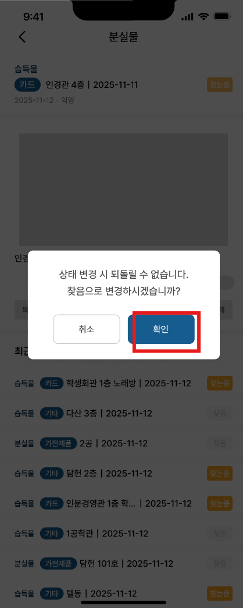
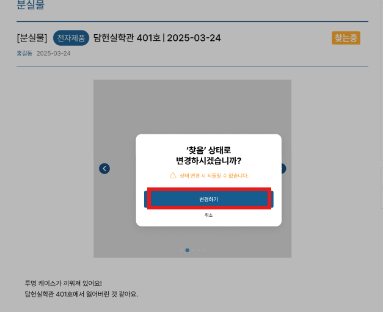

# 11-28. 분실물_찾음_버튼_클릭

[← 게시판 로깅 목록](README.md)

플랫폼: ANDROID · IOS · WEB  
원문 상태: 완료

과거 로깅·새 로깅과 각 참고사진은 원문의 구간별 연결을 유지합니다.

<!-- logging-section:past:start -->
## 과거 로깅

- 설명: 분실물 글에서 ‘찾는중’ 상태를 ‘찾음’ 상태로 변경하는 모달의 클릭 이벤트입니다. 확인버튼을 눌렀을 때만 로그가 찍히는 구조입니다.
- event\_label : lost\_item\_found
- value : ‘분실물’ or ‘습득물’
- event\_category : click

<!-- logging-section:past:end -->

<!-- logging-section:new:start -->
## 새 로깅

- 설명: 분실물 글에서 ‘찾는중’ 상태를 ‘찾음’ 상태로 변경하는 모달의 클릭 이벤트입니다. 확인버튼을 눌렀을 때만 로그가 찍히는 구조입니다.
- screen\_view: <code>lost_item_detail</code>
- event\_name: <code>DA2</code>
- event\_label: <code>board__lost_item_detail__lost_item_status__found_confirm__click</code>
- value: 분실물 / 습득물
- event\_category: <code>click</code>
- 발생 시점 확정: 상태 변경 확인 모달의 확인 버튼 클릭 시 전송한다. 11-27의 변경 진입과 별도 이벤트로 유지하며, 모달 취소와 서버 저장 성공 응답에서는 이 이벤트를 추가 전송하지 않는다.

### 참고사진 (기능 표시)

#### 웹

웹 — 찾음 상태 변경 확인 (기존 로깅 캡처)

모바일 — 찾음 상태 변경 확인 (기존 로깅 캡처)

파란색 구버전 모바일 사진 제거 (2026-10-30).

<!-- logging-section:new:end -->

---

원문 정보

원본 ID: `5cb0221954bc825bb7b281b63d3fe129`  
[보존 원문](../../_archive/original/notion/pages/5cb0221954bc825bb7b281b63d3fe129.md)

