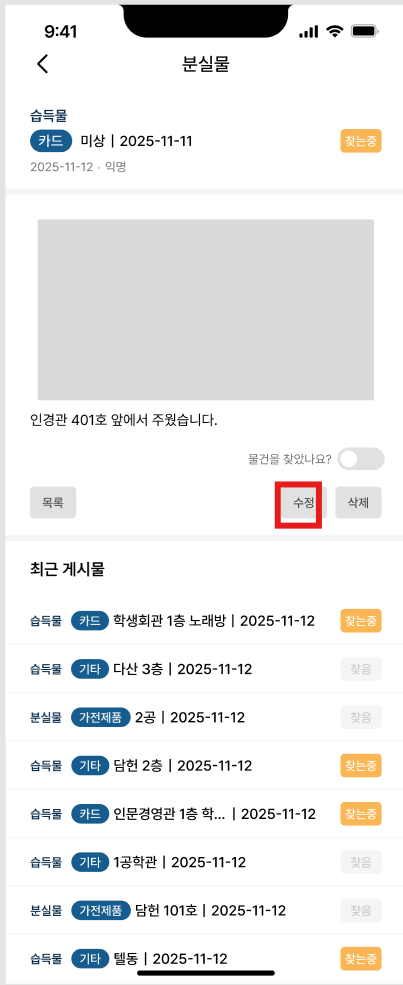
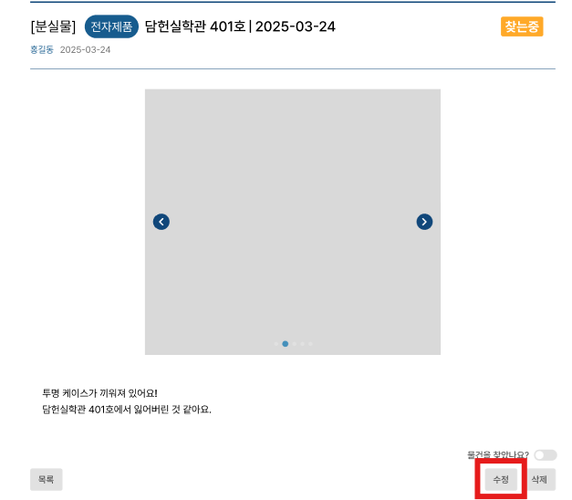
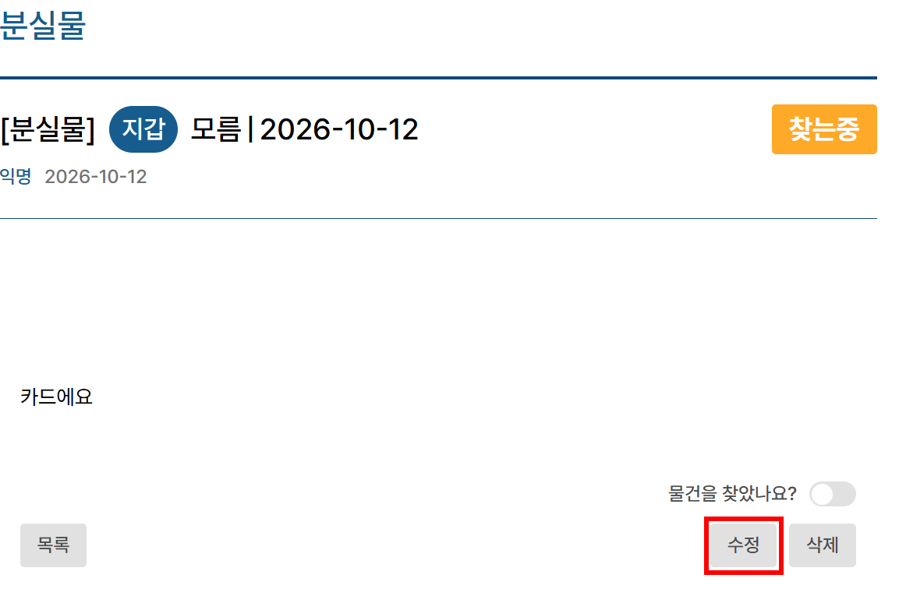
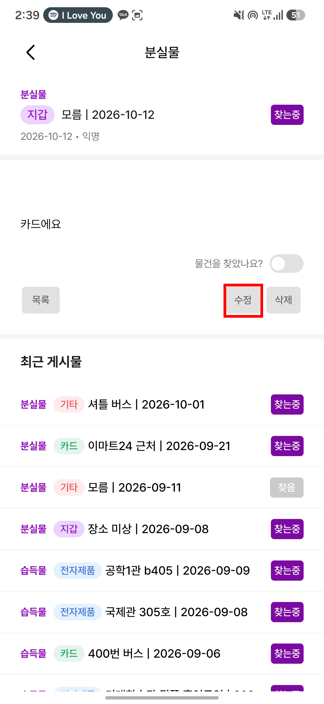

# 11-29. 분실물_수정_버튼_클릭

[← 게시판 목록](README.md)

플랫폼: ANDROID, IOS, WEB  
원문 상태: 완료  
[Notion 기준 명세](https://app.notion.com/p/f160221954bc826f9c06017be35f7f8e)  
원본 ID: `f160221954bc826f9c06017be35f7f8e`

<!-- notion-body:start -->
## 과거 로깅

- 설명: 분실물 글에서 수정 버튼을 클릭
- event\_label : lost\_item\_modify
- value : ‘습득물’ or ‘분실물’
- event\_category : click
- 참고사진





## 새 로깅

- 설명: 분실물 글에서 수정 버튼을 클릭
- screen\_view: <code>lost_item_detail</code>
- event\_name: <code>DA2</code>
- event\_label: <code>board__lost_item_detail__lost_item_edit__entry__click</code>
- value: 분실물 / 습득물
- event\_category: <code>click</code>

### 참고사진 (기능 표시)

<b>웹</b>

<b>참고사진 · 웹</b>

웹 — 본인 게시물 수정



<b>모바일</b>

<b>참고사진 · 모바일</b>

모바일 — 본인 게시물 수정


<!-- notion-body:end -->

<details>
<summary>Notion 원문 속성 전체</summary>

```json
{
  "platform": [
    "ANDROID",
    "IOS",
    "WEB"
  ],
  "url": "https://app.notion.com/p/f160221954bc826f9c06017be35f7f8e",
  "상태": "완료",
  "이름": "11-29. 분실물\\_수정\\_버튼\\_클릭",
  "태그": [
    "11.분실물"
  ]
}
```

</details>
