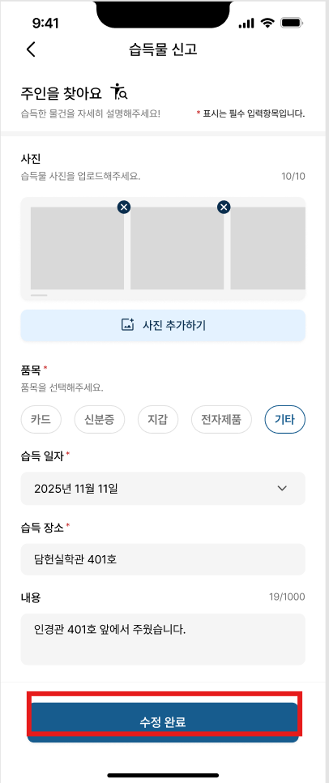
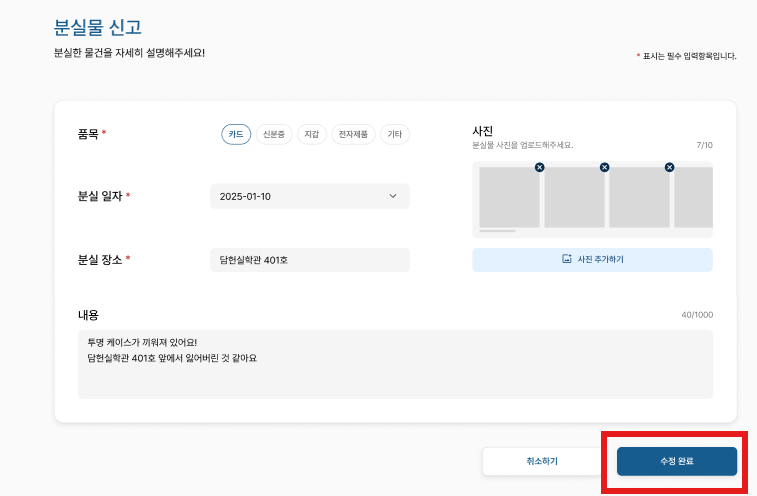
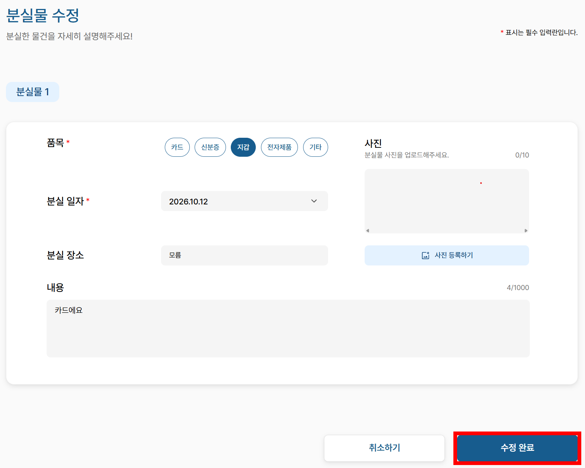
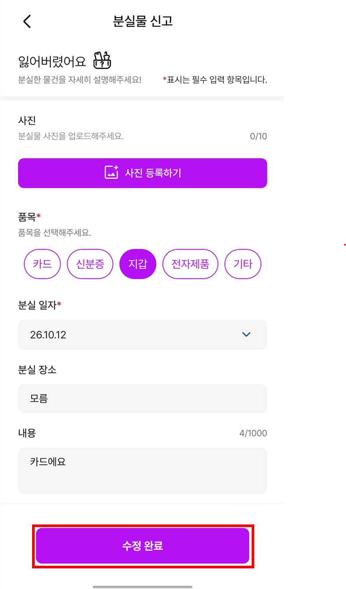

# 11-30. 분실물_수정완료_클릭

[← 게시판 목록](README.md)

플랫폼: ANDROID, IOS, WEB  
원문 상태: 완료  
[Notion 기준 명세](https://app.notion.com/p/1ac0221954bc835cab4981383980ccb1)  
원본 ID: `1ac0221954bc835cab4981383980ccb1`

<!-- notion-body:start -->
## 과거 로깅

- 설명: 수정화면에서 수정완료 클릭
- event\_label : lost\_item\_modify\_complete
- value : ‘분실물’ or ‘습득물’
- event\_category : click
- 참고사진





## 새 로깅

- 설명: 수정화면에서 수정완료 클릭
- screen\_view:
  - 분실물 수정: <code>lost_item_edit</code>
  - 습득물 수정: <code>found_item_edit</code>
- event\_name: <code>DA2</code>
- event\_label:
  - 분실물 수정: <code>board__lost_item_edit__lost_item_edit__submit</code>
  - 습득물 수정: <code>board__found_item_edit__lost_item_edit__submit</code>
- value: 분실물 / 습득물
- event\_category: <code>submit</code>

### 참고사진 (기능 표시)

<b>분실물 수정</b> — <code>lost_item_edit</code>

<b>웹</b>

<b>참고사진 · 웹</b>

웹 — 분실물 수정 완료



<b>모바일</b>

<b>참고사진 · 모바일</b>

모바일 — 분실물 수정 완료



<b>습득물 수정</b> — <code>found_item_edit</code>

<b>웹</b>

<b>참고사진 · 웹</b>

웹 — 습득물 수정 완료 (화면 정의의 공통 캡처)


<b>모바일</b>

<b>참고사진 · 모바일</b>

모바일 — 습득물 수정 완료 (화면 정의의 공통 캡처)


- 사진 기준 (2026-10-16 사용자 확인): 분실물 수정과 습득물 수정은 화면 제목 문구 차이만 있어 공통 사진과 텍스트 설명을 사용한다. 사용자가 작성한 설명과 첨부 사진을 유지하며 별도 사진 보완 과제로 남기지 않는다.
<!-- notion-body:end -->

<details>
<summary>Notion 원문 속성 전체</summary>

```json
{
  "platform": [
    "ANDROID",
    "IOS",
    "WEB"
  ],
  "url": "https://app.notion.com/p/1ac0221954bc835cab4981383980ccb1",
  "상태": "완료",
  "이름": "11-30. 분실물\\_수정완료\\_클릭",
  "태그": [
    "11.분실물"
  ]
}
```

</details>
