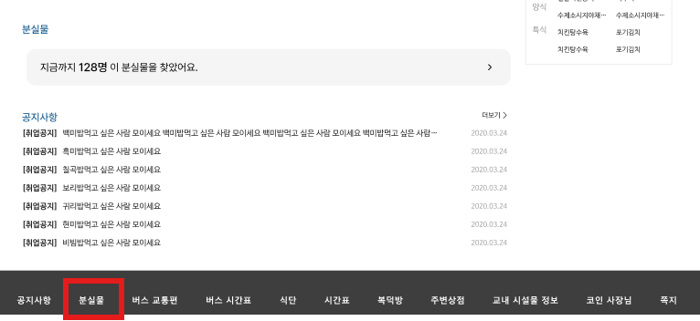

# 11-31. 푸터_분실물_클릭

[← 게시판 목록](README.md)

플랫폼: WEB  
원문 상태: 완료  
[Notion 기준 명세](https://app.notion.com/p/1660221954bc835a917d01ac06416efe)  
원본 ID: `1660221954bc835a917d01ac06416efe`

<!-- notion-body:start -->
## 과거 로깅

- 설명: 푸터의 분실물 클릭시 발생하는 로그입니다.
- event\_label : footer
- value : 분실물
- event\_category : click
- 참고사진



## 새 로깅

- 설명: 푸터의 분실물 클릭시 발생하는 로그입니다.
- screen\_view: <code>footer</code>
- event\_name: <code>DA2</code>
- event\_label: <code>board__footer__lost_item_entry__footer_entry__click</code>
- value: 분실물
- event\_category: <code>click</code>

### 참고사진 (WEB 리디자인 · 푸터 분실물)

<b>웹</b>

<b>참고사진 · 웹</b>

[Figma 원본](https://www.figma.com/design/DPlcYuiFxhyT5ULbqec59i/KOIN-Web?node-id=17664-28870) · 2026-11-04. 원본 캡처에 빨간 네모만 추가했다. 빨간 네모는 기존 명세의 분실물 클릭 위치다. 실제 SDK 적용·배포·전송은 미확인이다.


<!-- notion-body:end -->

<details>
<summary>Notion 원문 속성 전체</summary>

```json
{
  "platform": [
    "WEB"
  ],
  "url": "https://app.notion.com/p/1660221954bc835a917d01ac06416efe",
  "상태": "완료",
  "이름": "11-31. 푸터\\_분실물\\_클릭",
  "태그": [
    "11.분실물"
  ]
}
```

</details>
