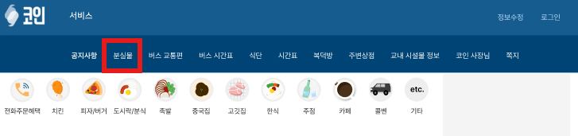
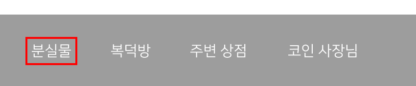

# 11-32. 헤더_분실물_클릭

[← 게시판 목록](README.md)

플랫폼: WEB  
원문 상태: 완료  
[Notion 기준 명세](https://app.notion.com/p/1b90221954bc8329b70481d0ed1eb751)  
원본 ID: `1b90221954bc8329b70481d0ed1eb751`

<!-- notion-body:start -->
## 과거 로깅

- 설명: 푸터의 분실물 클릭시 발생하는 로그입니다.
- event\_label : header
- value : 분실물
- event\_category : click
- 참고사진



## 새 로깅

- 설명: 웹 헤더에서 분실물 항목을 클릭하여 목록으로 진입.
- screen\_view: <code>header</code>
- event\_name: <code>DA2</code>
- event\_label: <code>board__header__lost_item_entry__header_entry__click</code>
- value: 분실물
- event\_category: <code>click</code>

### 참고사진 (생활편의 → 분실물 · WEB 리디자인)

<b>웹</b>

<b>참고사진 · 웹</b>

생활편의 → 분실물. 출처: [Figma WEB 리디자인](https://www.figma.com/design/DPlcYuiFxhyT5ULbqec59i/KOIN-Web?node-id=11541-33352), 2026-11-04 원본 캡처에 코드로 빨간 네모만 추가. 빨간 네모는 기존 명세가 지칭하는 클릭 대상이다. 실제 클릭 가능 여부·SDK 적용·배포·수집은 미확인이다.


<!-- notion-body:end -->

<details>
<summary>Notion 원문 속성 전체</summary>

```json
{
  "platform": [
    "WEB"
  ],
  "url": "https://app.notion.com/p/1b90221954bc8329b70481d0ed1eb751",
  "상태": "완료",
  "이름": "11-32. 헤더\\_분실물\\_클릭",
  "태그": [
    "11.분실물"
  ]
}
```

</details>
