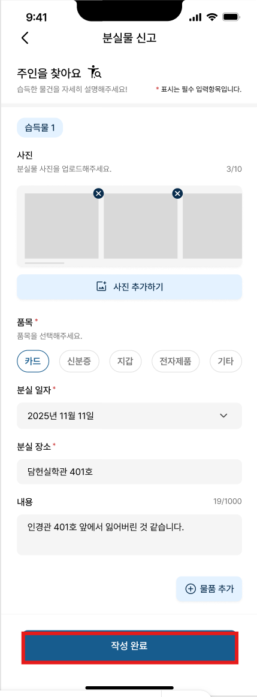
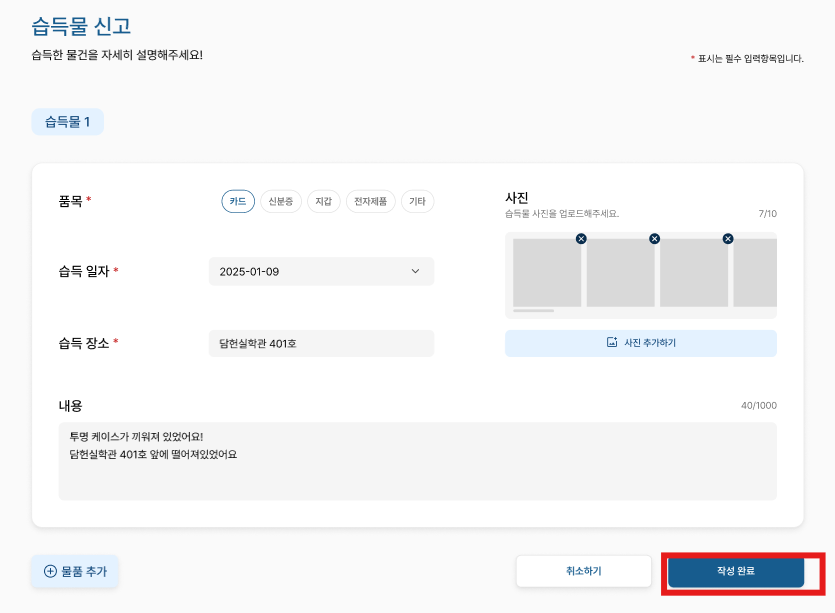
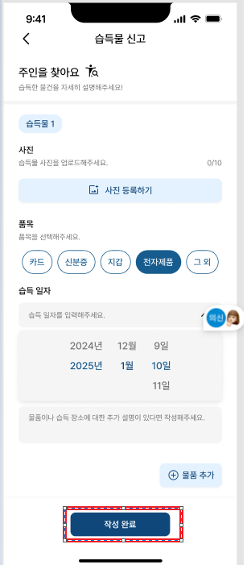
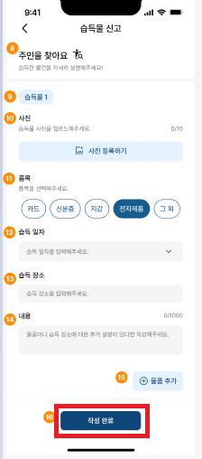
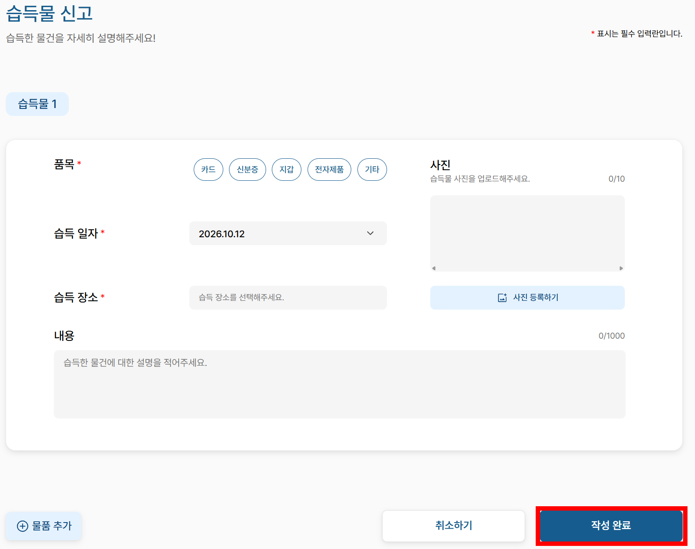
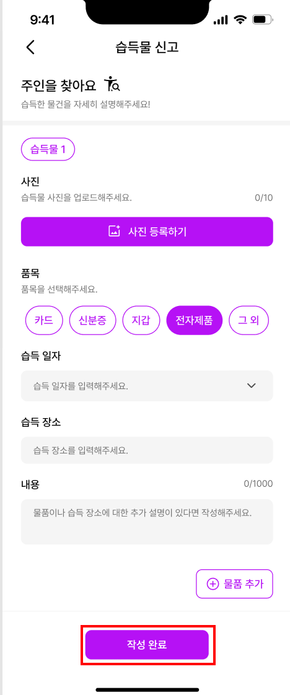

# 11-4.분실물_습득물신고_작성완료_클릭

[← 게시판 로깅 목록](README.md)

플랫폼: ANDROID · IOS · WEB  
원문 상태: 완료

과거 로깅·새 로깅과 각 참고사진은 원문의 구간별 연결을 유지합니다.

<!-- logging-section:past:start -->
## 과거 로깅

- 설명:  습득물 신고 글쓰기 페이지에서 작성완료 클릭

- event\_label : “find\_user\_write\_confirm”

- value : “작성완료” 

- event\_category : “click”

<b>이전 참고사진</b>

WEB Mobile View

<!-- logging-section:past:end -->

<!-- logging-section:new:start -->
## 새 로깅

- 설명: 습득물 신고 글쓰기 화면에서 작성완료 버튼을 눌러 작성 내용을 제출.
- screen\_view: <code>found_item_write</code>
- event\_name: <code>DA2</code>
- event\_label: <code>board__found_item_write__lost_item_write__submit</code>
- value: 작성완료
- event\_category: <code>submit</code>

### 참고사진 (기능 표시)

#### 웹

웹 — 습득물 작성 완료

#### 모바일

모바일 — 습득물 작성 완료

<!-- logging-section:new:end -->

---

원문 정보

원본 ID: `35d0221954bc838c872c8173f1d6171a`  
[보존 원문](../../_archive/original/notion/pages/35d0221954bc838c872c8173f1d6171a.md)

