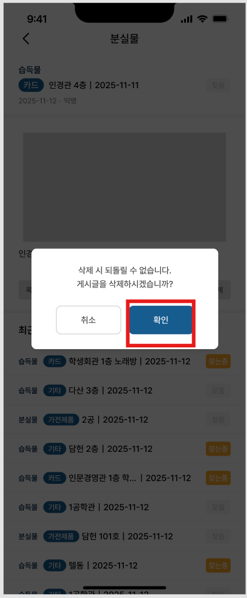
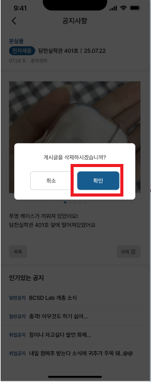
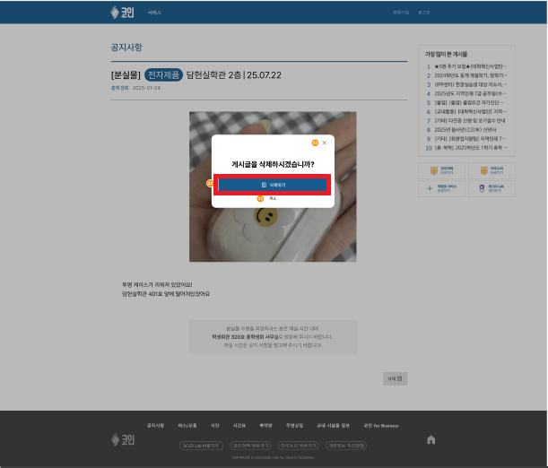
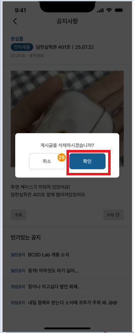
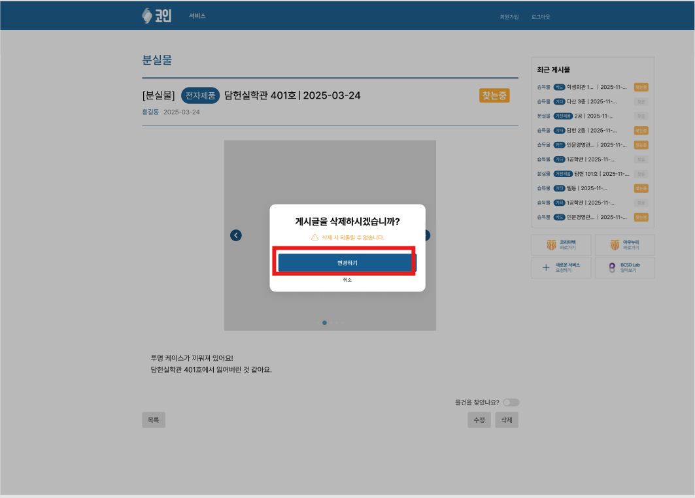

# 11-6.분실물_습득물신고_삭제확인_클릭

[← 게시판 로깅 목록](README.md)

플랫폼: ANDROID · IOS · WEB  
원문 상태: 완료

과거 로깅·새 로깅과 각 참고사진은 원문의 구간별 연결을 유지합니다.

<!-- logging-section:past:start -->
## 이전 로깅

- 설명:  글 작성자가 습득물 신고 게시물을 삭제버튼을 클릭하고, 나타나는 창에서 확인 버튼을 클릭
- event\_label : “find\_user\_delete\_confirm”
- value : “확인”
- event\_category : “click”

이전 참고사진

WEB Mobile View

<!-- logging-section:past:end -->

<!-- logging-section:new:start -->
## 새 로깅 (26.10.12) — 초안

- 설명: 글 작성자가 습득물 신고 게시물을 삭제버튼을 클릭하고, 나타나는 창에서 확인 버튼을 클릭
- screen\_view: <code>lost_item_detail</code>
- event\_name: <code>DA2</code>
- event\_label: <code>board__lost_item_detail__lost_item_delete__confirm__click</code>
- value: 확인
- event\_category: <code>click</code>

검토사항

- 통합 가이드·후속: 원문 (원문 ID: 4129ae650b598060bb4bdf347b7d4c7a)
- label 통일 (2026-10-27): <code>board__lost_item_detail__lost_item_delete__confirm</code> → <code>board__lost_item_detail__lost_item_delete__confirm__click</code>
- 삭제 확인 버튼 클릭 시점입니다. 실제 삭제 성공 시점과 구분합니다.

참고사진 · 웹

웹 — 삭제 확인 (기존 로깅 캡처)

참고사진 · 모바일

모바일 — 삭제 확인 (기존 로깅 캡처)

파란색 구버전 모바일 사진 제거 (2026-10-30).

<!-- logging-section:new:end -->

---

원문 정보

원본 ID: `9170221954bc83f2851481fa2a35103c`  
[보존 원문](../../_archive/original/notion/pages/9170221954bc83f2851481fa2a35103c.md)

