# 11-7·11-8.분실물_글종류선택(잃어버렸어요·주인을찾아요)_클릭

[← 게시판 목록](README.md)

플랫폼: ANDROID, IOS, WEB  
원문 상태: 완료  
[Notion 기준 명세](https://app.notion.com/p/2a70221954bc83d6821f81570b8cf95b)  
원본 ID: `2a70221954bc83d6821f81570b8cf95b`

<!-- notion-body:start -->
## 과거 로깅

- 설명: 분실물 페이지 에서 글쓰기 버튼 클릭 후 나타나는  잃어버렸어요 버튼 클릭
- event\_label : “lost\_item\_write”
- value : “잃어버렸어요”
- event\_category : “click”
- 참고사진

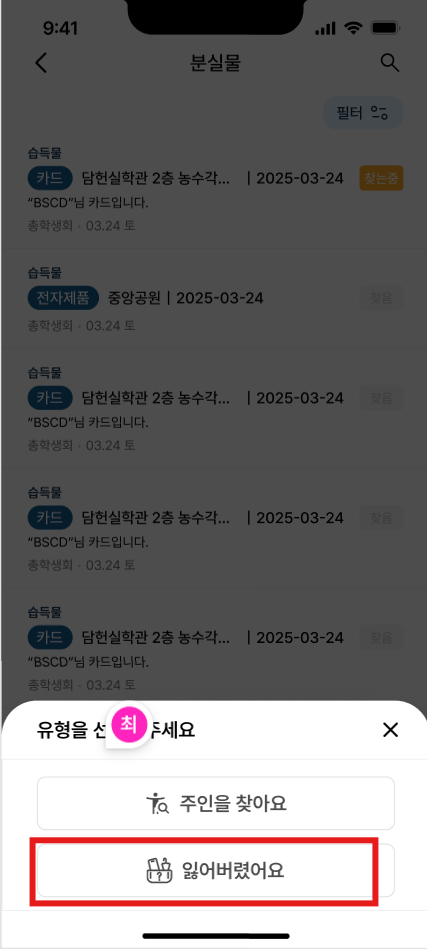

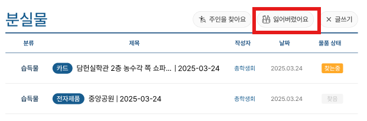

<b>이전 참고사진</b>

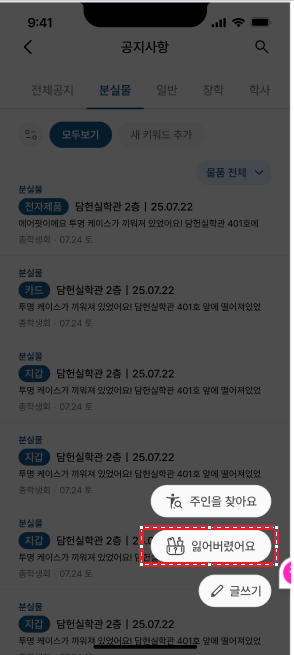

WEB

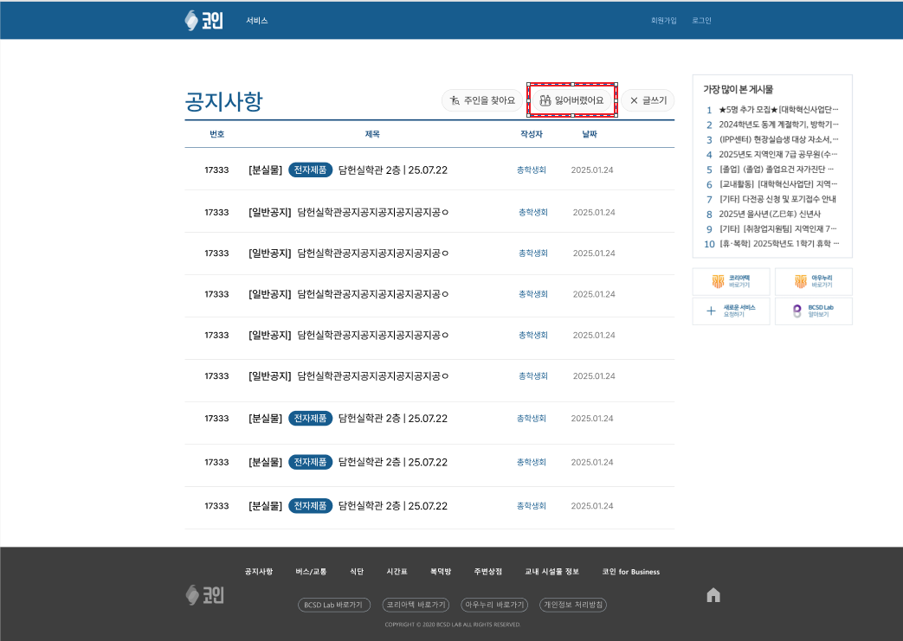

Mobile\_WEB\_VIEW

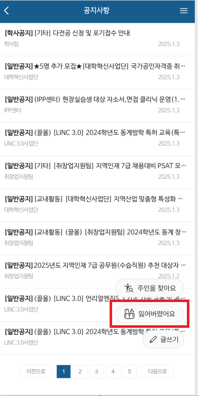

- 설명: 분실물 페이지 에서 글쓰기 버튼 클릭 후 나타나는  주인을 찾아요 버튼 클릭
- event\_label : “find\_user\_write”
- value : “주인을 찾아요”
- event\_category : “click”
- 참고사진

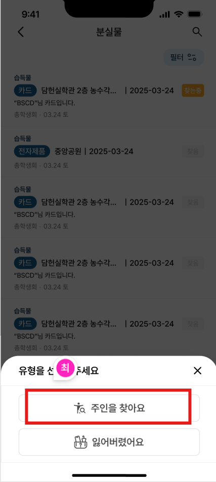

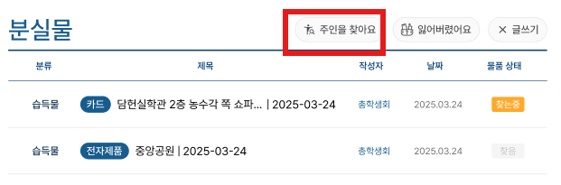

<b>이전 참고사진 \[11-8 원문\]</b>

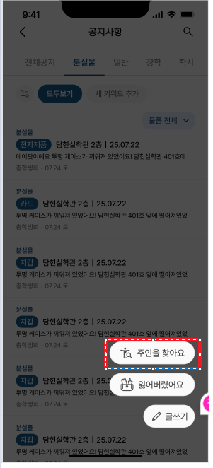

WEB

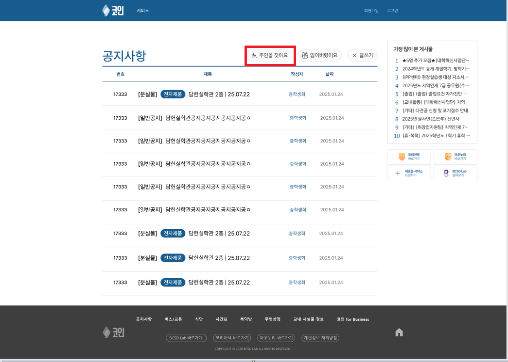

Mobile\_Web\_View

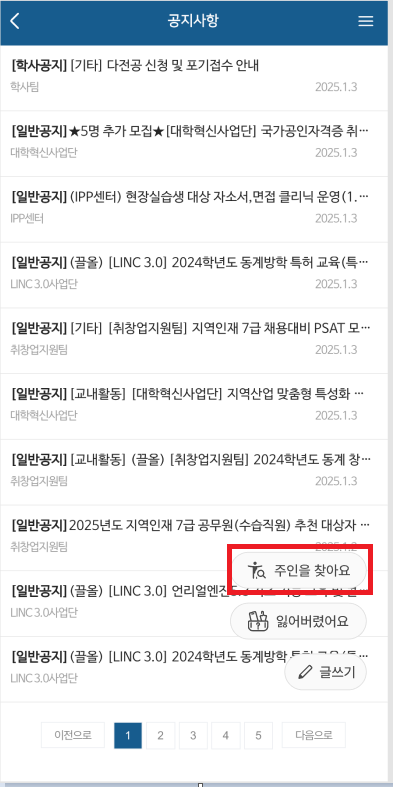

## 새 로깅

- 설명: 분실물 페이지에서 글쓰기 버튼 클릭 후 나타나는 글 종류 선택(잃어버렸어요 / 주인을 찾아요) 버튼 클릭. 11-7(잃어버렸어요)과 11-8(주인을 찾아요) 두 버튼을 하나의 이벤트로 묶고 value로 구분한다.
- screen\_view: <code>lost_item_list</code> (11-7·11-8 동일)
- event\_name: <code>DA2</code>
- event\_label: <code>board__lost_item_list__lost_item_write__post_type__select</code>
- value: 잃어버렸어요 또는 주인을 찾아요
- event\_category: <code>select</code>

### 참고사진 (기능 표시)

<b>웹</b>

<b>참고사진 · 웹</b>

웹 — 잃어버렸어요 (11-7)

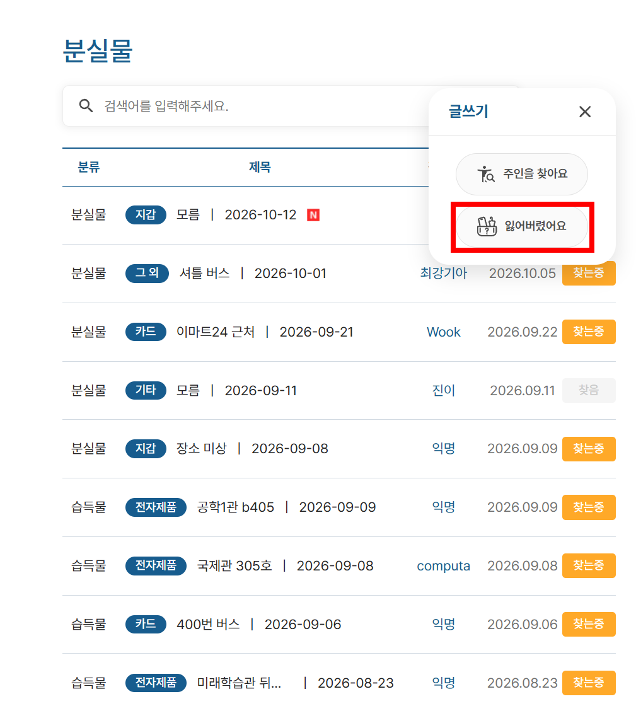

웹 — 주인을 찾아요 (11-8)

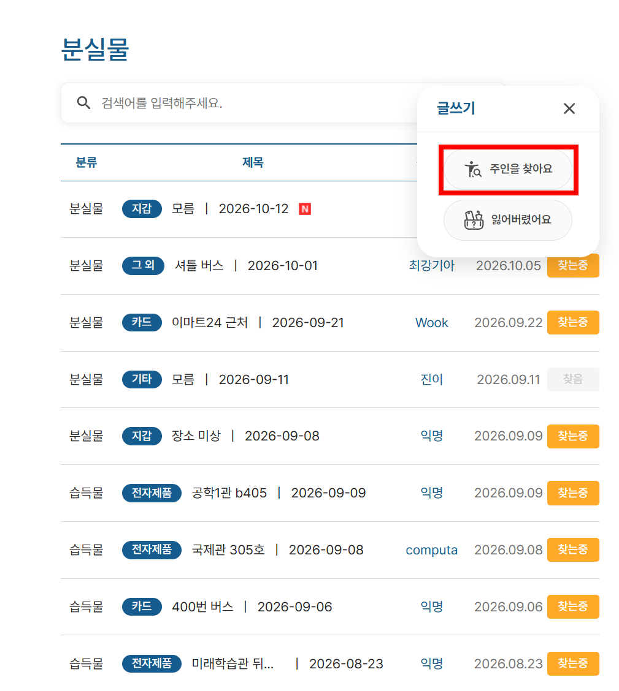

<b>모바일</b>

<b>참고사진 · 모바일</b>

모바일 — 잃어버렸어요 (11-7)

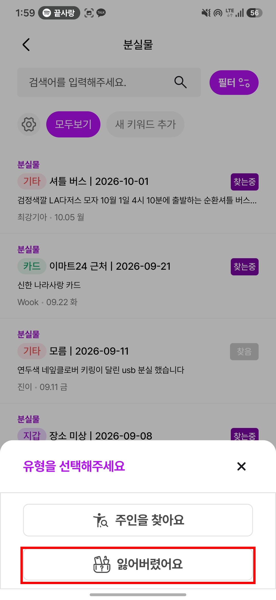

모바일 — 주인을 찾아요 (11-8)

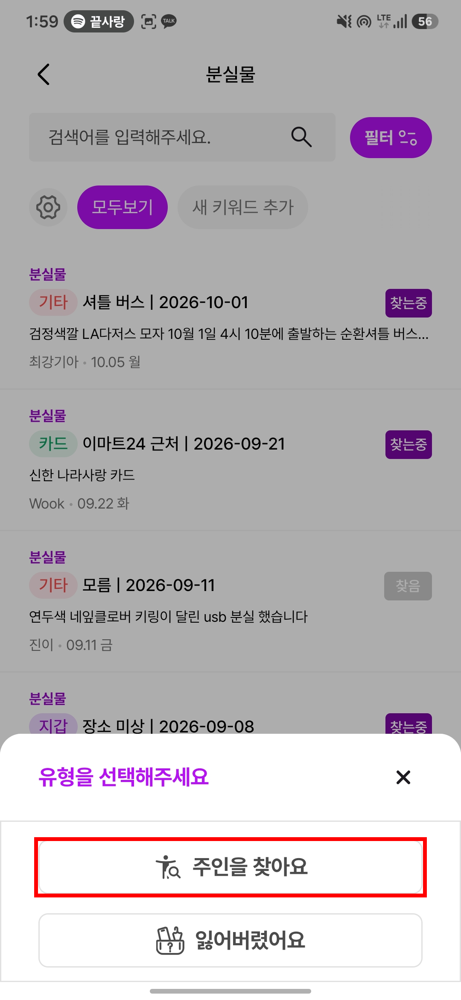
<!-- notion-body:end -->

<details>
<summary>Notion 원문 속성 전체</summary>

```json
{
  "platform": [
    "ANDROID",
    "IOS",
    "WEB"
  ],
  "url": "https://app.notion.com/p/2a70221954bc83d6821f81570b8cf95b",
  "상태": "완료",
  "이름": "11-7·11-8.분실물\\_글종류선택(잃어버렸어요·주인을찾아요)\\_클릭",
  "태그": [
    "11.분실물"
  ]
}
```

</details>
