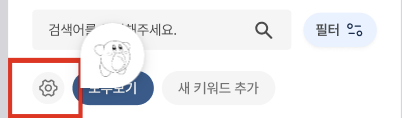
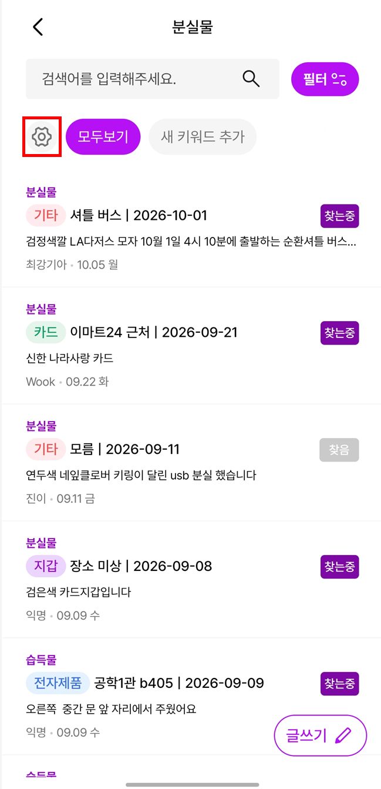

# 12-1. 키워드 설정_클릭

[← 게시판 로깅 목록](README.md)

플랫폼: ANDROID · IOS  
원문 상태: 로깅 필요

과거 로깅·새 로깅과 각 참고사진은 원문의 구간별 연결을 유지합니다.

<!-- logging-section:past:start -->
## 과거 로깅

- 설명: 화면 상단의 설정 버튼 클릭
- event\_label: “lost\_item\_keyword\_setting”
- value: “키워드 설정”
- event\_category: “click”
- 참고 사진

<!-- logging-section:past:end -->

<!-- logging-section:new:start -->
## 새 로깅

- 설명: 분실물 화면 상단의 키워드 설정 버튼을 클릭하여 키워드 관리로 진입.
- screen\_view: <code>lost_item_list</code>
- event\_name: <code>DA2</code>
- event\_label: <code>board__lost_item_list__keyword_manage__entry__click</code>
- value: 키워드 설정
- event\_category: <code>click</code>

### 참고사진 (기능 표시)

<b>웹</b>

화면 정의에 웹 화면 없음.

<b>모바일</b>

<b>참고사진 · 모바일</b>

모바일 — 키워드 설정 톱니바퀴

<!-- logging-section:new:end -->

---

원문 정보

원본 ID: `69b0221954bc8358be2081af0c1b0bd9`  
[보존 원문](../../_archive/original/notion/pages/69b0221954bc8358be2081af0c1b0bd9.md)

