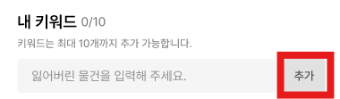
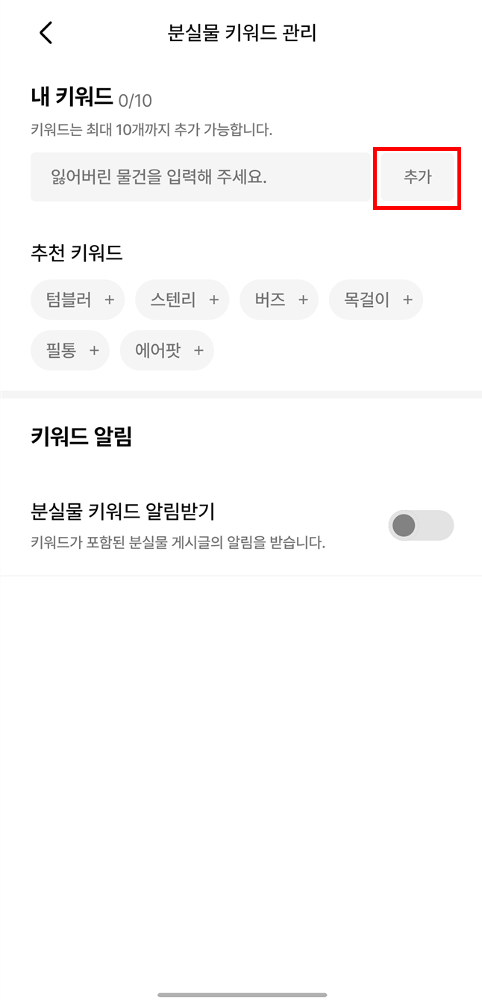

# 12-2. 키워드 추가_클릭

[← 게시판 로깅 목록](README.md)

플랫폼: ANDROID · IOS  
원문 상태: 로깅 필요

과거 로깅·새 로깅과 각 참고사진은 원문의 구간별 연결을 유지합니다.

<!-- logging-section:past:start -->
## 과거 로깅

- 설명: 내 키워드 추가 클릭
- event\_label: “lost\_item\_keyword\_add”
- value: “키워드 추가”
- event\_category: “click”
- 참고사진

<!-- logging-section:past:end -->

<!-- logging-section:new:start -->
## 새 로깅

- 설명: 입력한 키워드를 ‘추가’ 버튼으로 최종 추가한다.
- screen\_view: <code>lost_item_keyword_manage</code>
- event\_name: <code>DA2</code>
- event\_label: <code>board__lost_item_keyword_manage__keyword_manage__add__submit</code>
- value: <code>{추가 버튼 클릭 시 입력된 키워드}</code> — 동적 STRING. 버튼을 누른 시점에 최종 추가하는 키워드 문자열을 저장한다.
- event\_category: <code>submit</code>

### 참고사진 (기능 표시)

<b>웹</b>

화면 정의에 웹 화면 없음.

<b>모바일</b>

<b>참고사진 · 모바일</b>

모바일 — 내 키워드 추가

<!-- logging-section:new:end -->

---

원문 정보

원본 ID: `8790221954bc82a1936481173d50c213`  
[보존 원문](../../_archive/original/notion/pages/8790221954bc82a1936481173d50c213.md)

