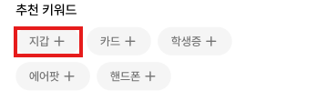
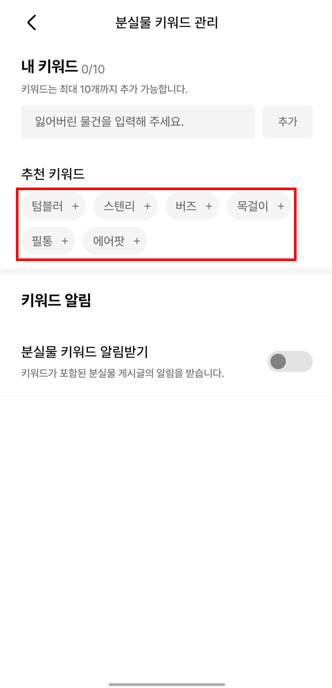

# 12-3. 추천 키워드_클릭

[← 게시판 로깅 목록](README.md)

플랫폼: ANDROID · IOS  
원문 상태: 로깅 필요

과거 로깅·새 로깅과 각 참고사진은 원문의 구간별 연결을 유지합니다.

<!-- logging-section:past:start -->
## 과거 로깅

- 설명: 추천 키워드에 있는 키워드 클릭
- event\_label: “lost\_item\_keyword\_recommend”
- value: \{”지갑”, ”카드”, ”학생증”, ”에어팟”, ”핸드폰”\} 5가지 값을 추가
- event\_category: “click”
- 참고사진

<!-- logging-section:past:end -->

<!-- logging-section:new:start -->
## 새 로깅

- 설명: 추천 목록에서 키워드를 선택하는 순간 실제 선택한 키워드를 전송한다. 추천 목록은 바뀔 수 있다.
- screen\_view: <code>lost_item_keyword_manage</code>
- event\_name: <code>DA2</code>
- event\_label: <code>board__lost_item_keyword_manage__keyword_manage__recommended_keyword__select</code>
- value: <code>{클릭한 추천 키워드}</code> — 동적 STRING. 클릭한 시점에 화면에 표시된 추천 키워드를 매핑해 전송하며 고정 다섯 값으로 제한하지 않는다.
- event\_category: <code>select</code>

### 참고사진 (기능 표시)

<b>웹</b>

화면 정의에 웹 화면 없음.

<b>모바일</b>

<b>참고사진 · 모바일</b>

모바일 — 추천 키워드

<!-- logging-section:new:end -->

---

원문 정보

원본 ID: `2300221954bc82548853817eed8c1272`  
[보존 원문](../../_archive/original/notion/pages/2300221954bc82548853817eed8c1272.md)

