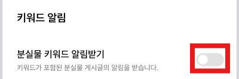
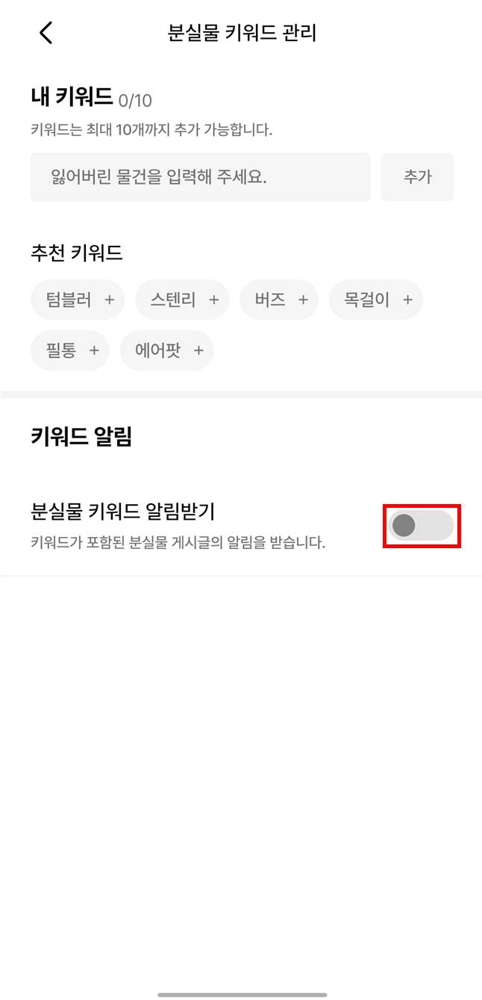

# 12-4. 키워드 알림받기_클릭

[← 게시판 목록](README.md)

플랫폼: ANDROID, IOS  
원문 상태: 로깅 필요  
[Notion 기준 명세](https://app.notion.com/p/33f0221954bc82e393d881185b14d4b8)  
원본 ID: `33f0221954bc82e393d881185b14d4b8`

<!-- notion-body:start -->
## 과거 로깅

- 설명: 키워드 알림받기 클릭
- event\_label: “lost\_item\_keyword\_alarm”
- value: “키워드 알림받기”
- event\_category: “click”
- 참고사진



## 새 로깅

- 설명: 키워드 알림받기 클릭
- screen\_view: <code>lost_item_keyword_manage</code>
- event\_name: <code>DA2</code>
- event\_label: <code>board__lost_item_keyword_manage__keyword_manage__notification__click</code>
- value: 받기 / 끄기 — 사용자 조작 직후 변경된 상태 기준. 알림을 켜면 받기, 끄면 끄기를 전송한다.
- event\_category: <code>click</code>

### 참고사진 (기능 표시)

<b>웹</b>

화면 정의에 웹 화면 없음.

<b>모바일</b>

<b>참고사진 · 모바일</b>

모바일 — 키워드 알림받기 토글


<!-- notion-body:end -->

<details>
<summary>Notion 원문 속성 전체</summary>

```json
{
  "platform": [
    "ANDROID",
    "IOS"
  ],
  "url": "https://app.notion.com/p/33f0221954bc82e393d881185b14d4b8",
  "상태": "로깅 필요",
  "이름": "12-4. 키워드 알림받기\\_클릭",
  "태그": [
    "12. 분실물 키워드"
  ]
}
```

</details>
