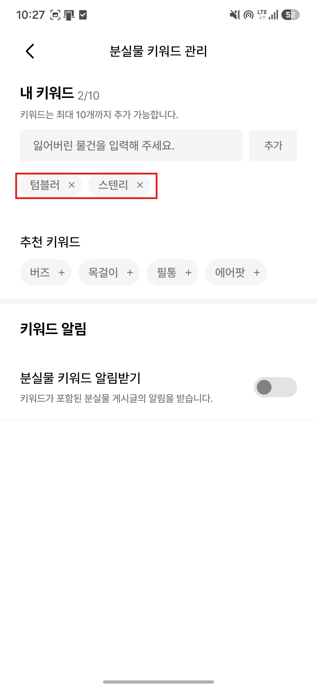

# 12-5. 키워드 삭제_클릭

[← 게시판 로깅 목록](README.md)

플랫폼: ANDROID · IOS  
원문 상태: 로깅 필요

과거 로깅·새 로깅과 각 참고사진은 원문의 구간별 연결을 유지합니다.

<!-- logging-section:past:start -->
## 이전 로깅

- 설명: 설정된 키워드 삭제 클릭
- event\_label: “lost\_item\_keyword\_remove”
- value: 설정된 키워드 이름
- event\_category: “click”

<!-- logging-section:past:end -->

<!-- logging-section:new:start -->
## 새 로깅 (26.10.12) — 초안

- 설명: 설정된 키워드 삭제 클릭
- screen\_view: <code>lost_item_keyword_manage</code>
- event\_name: <code>DA2</code>
- event\_label: <code>board__lost_item_keyword_manage__keyword_manage__delete__click</code>
- value: \{삭제한 키워드\}
- event\_category: <code>click</code>

검토사항

- label 통일 (2026-10-27): <code>board__lost_item_keyword_manage__keyword_manage__delete_click</code> → <code>board__lost_item_keyword_manage__keyword_manage__delete__click</code>

화면 정의에 웹 화면 없음.

참고사진 · 모바일

모바일 — 등록된 키워드의 삭제. 2026-10-16 사용자가 현재 버전 캡처로 수정 완료한 사진을 유지한다. 

<!-- logging-section:new:end -->

---

원문 정보

원본 ID: `3190221954bc8304a7f3019766eafe36`  
[보존 원문](../../_archive/original/notion/pages/3190221954bc8304a7f3019766eafe36.md)

