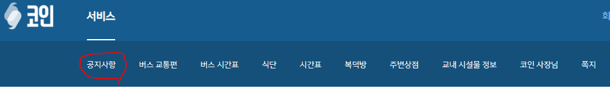

# 2-1. 헤더_공지사항_클릭

[← 게시판 로깅 목록](README.md)

플랫폼: WEB  
원문 상태: 로깅 필요

과거 로깅·새 로깅과 각 참고사진은 원문의 구간별 연결을 유지합니다.

<!-- logging-section:past:start -->
## 과거 로깅

- 설명: 헤더 에서 공지사항 클릭
- event\_label : “header”
- value : “공지사항”
- event\_category : “click”
- 참고사진

<!-- logging-section:past:end -->

<!-- logging-section:new:start -->
## 새 로깅

- 설명: 웹 헤더의 공지사항 메뉴 클릭.
- screen\_view: <code>header</code>
- event\_name: <code>DA2</code>
- event\_label: <code>board__header__notice_entry__header_entry__click</code>
- value: 공지사항
- event\_category: <code>click</code>

### 참고사진 (커뮤니티 → 공지사항 · WEB 리디자인)

<b>웹</b>

<b>참고사진 · 웹</b>

커뮤니티 → 공지사항. 출처: [Figma WEB 리디자인](https://www.figma.com/design/DPlcYuiFxhyT5ULbqec59i/KOIN-Web?node-id=11541-33352), 2026-11-04 원본 캡처에 코드로 빨간 네모만 추가. 빨간 네모는 기존 명세가 지칭하는 클릭 대상이다. 실제 클릭 가능 여부·SDK 적용·배포·수집은 미확인이다.

<!-- logging-section:new:end -->

---

원문 정보

원본 ID: `c6e0221954bc83ab9b86018800c682ad`  
[보존 원문](../../_archive/original/notion/pages/c6e0221954bc83ab9b86018800c682ad.md)

