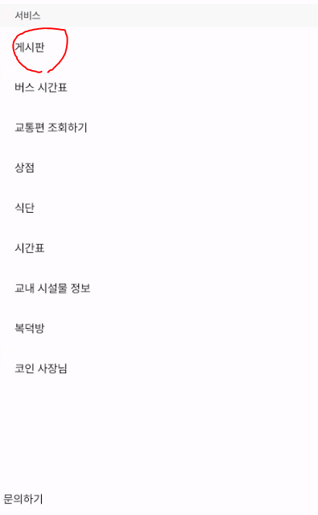

# 2-3. 공지사항_클릭 (레거시)

[← 게시판 로깅 목록](README.md)

플랫폼: ANDROID · IOS  
원문 상태: 로깅 필요

과거 로깅·새 로깅과 각 참고사진은 원문의 구간별 연결을 유지합니다.

원문 미기재 항목: `event_name`, `screen_view`. 값을 추정하지 않았습니다.

<callout icon="📁" color="gray_bg">
<b>레거시 보존 · 현행 새 로깅은 홈으로 이관</b>

- 2026-11-04 사용자 지시로 이 페이지는 이력만 보존한다.
- 현행 기준 명세: [2-3 네비게이션 바 게시판 클릭](../10-%ED%99%88%ED%99%94%EB%A9%B4-%EB%A6%AC%EB%94%94%EC%9E%90%EC%9D%B8/2-3-%EB%84%A4%EB%B9%84%EA%B2%8C%EC%9D%B4%EC%85%98-%EB%B0%94-%EA%B2%8C%EC%8B%9C%ED%8C%90-%ED%81%B4%EB%A6%AD.md).
- 이관 후 event\_label: <code>main__main__notice_entry__navigation_entry__click</code>. 아래 이관 전 라벨·값·사진은 보존 기록이며 별도 신규 구현·추가 전송 대상으로 사용하지 않는다.
- 실제 SDK 전환·배포·수집 중단 여부는 미확인이다. 기존 플랫폼과 상태 속성은 유지했다.
</callout>

<!-- logging-section:past:start -->
## 이전 로깅

- 설명: 햄버거 에서 공지사항(게시판) 클릭
- event\_label : “hamburger”
- value : “공지사항”
- event\_category : “click”
- 참고사진

<!-- logging-section:past:end -->

---

원문 정보

원본 ID: `b0e0221954bc837f84bd01e0768a57c0`  
[보존 원문](../../_archive/original/notion/pages/b0e0221954bc837f84bd01e0768a57c0.md)

