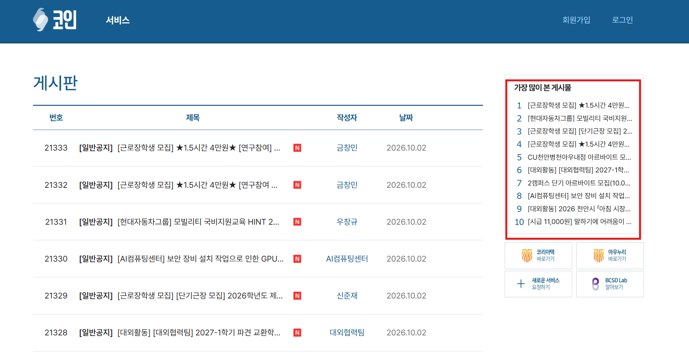

# 3-1. 공지사항_가장 많이 본 게시물_클릭

[← 게시판 목록](README.md)

플랫폼: WEB  
원문 상태: 로깅 필요  
[Notion 기준 명세](https://app.notion.com/p/a360221954bc8326af0781e8a69edc77)  
원본 ID: `a360221954bc8326af0781e8a69edc77`

<!-- notion-body:start -->
## 과거 로깅

- 설명: 공지사항 페이지에서 가장 많이본 게시물 1\~10번중 클릭했을때
- event\_label : “notice\_hot”
- value : “”
- event\_category : “click”
- 참고사진


## 새 로깅

- 설명: 공지사항 화면에서 가장 많이 본 게시물 영역의 게시글 클릭.
- screen\_view: <code>main_notice</code>
- event\_name: <code>DA2</code>
- event\_label: <code>board__main_notice__notice_detail__popular_post_entry__click</code>
- value: \{공지ID\}

  - ID가 안되면 공지제목으로 넣어주시면 감사하겠습니다! (조치 후 결과 아래에 남겨주세요)
- event\_category: <code>click</code>

<b>참고사진 · 웹</b>

<b>웹</b>


<!-- notion-body:end -->

<details>
<summary>Notion 원문 속성 전체</summary>

```json
{
  "platform": [
    "WEB"
  ],
  "url": "https://app.notion.com/p/a360221954bc8326af0781e8a69edc77",
  "상태": "로깅 필요",
  "이름": "3-1. 공지사항\\_가장 많이 본 게시물\\_클릭",
  "태그": [
    "3. 공지사항 상세 페이지"
  ]
}
```

</details>
