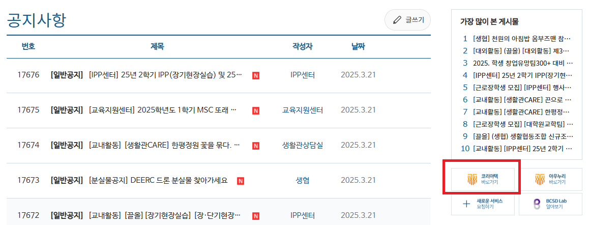
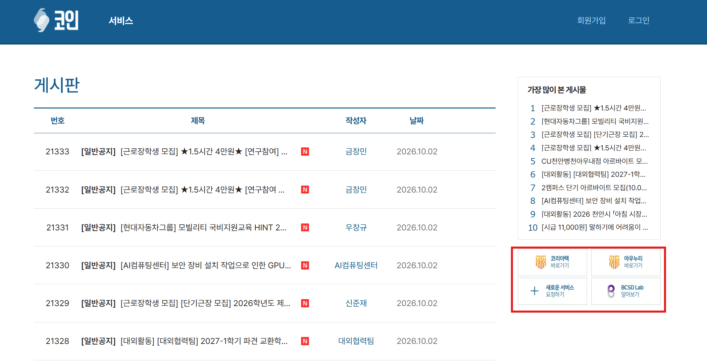

# 3-2. 공지사항_바로가기_클릭

[← 게시판 로깅 목록](README.md)

플랫폼: WEB  
원문 상태: 로깅 필요

과거 로깅·새 로깅과 각 참고사진은 원문의 구간별 연결을 유지합니다.

<!-- logging-section:past:start -->
## 과거 로깅

- 설명: 공지사항 페이지 에서 코리아텍 바로가기 클릭
- event\_label : “short\_cut”
- value : “\{바로가기 타이틀\}”
- event\_category : “click”
- 참고사진

<!-- logging-section:past:end -->

<!-- logging-section:new:start -->
## 새 로깅

- 설명: 공지사항 화면의 코리아텍 바로가기 클릭.
- screen\_view: <code>main_notice</code>
- event\_name: <code>DA2</code>
- event\_label: <code>board__main_notice__external_link__shortcut_entry__click</code>
- value: \{클릭한 페이지 제목\}
  - ‘코리아텍 바로가기’ or ‘아우누리 바로가기’ or ‘새로운 서비스 요청하기’ or ‘BCSD Lab 알아보기’
- event\_category: <code>click</code>

<b>참고사진 · 웹</b>

<b>웹</b>

<!-- logging-section:new:end -->

---

원문 정보

원본 ID: `3770221954bc82b1be09010ad7e36c85`  
[보존 원문](../../_archive/original/notion/pages/3770221954bc82b1be09010ad7e36c85.md)

