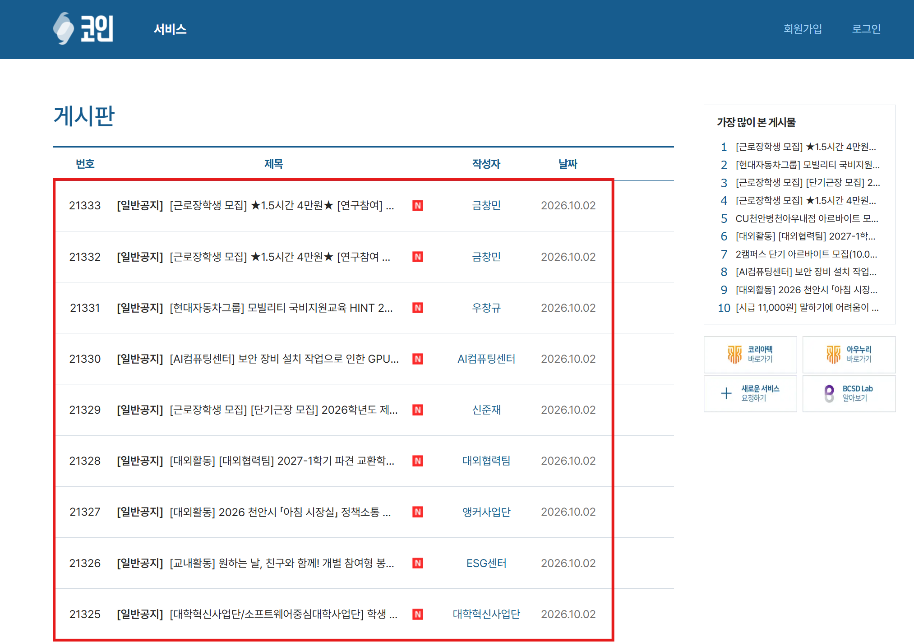
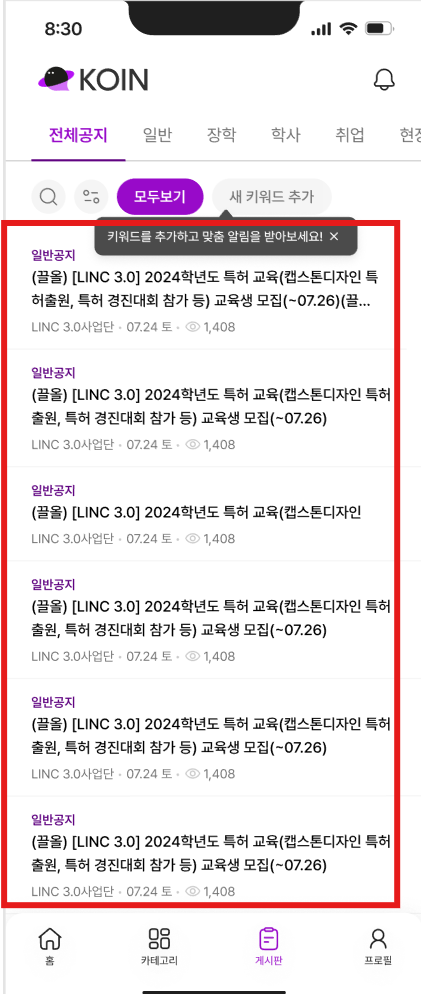

# 3-3. 공지사항_상세_클릭 (웹·앱)

[← 게시판 목록](README.md)

플랫폼: WEB, ANDROID, IOS  
원문 상태: 로깅 필요  
[Notion 기준 명세](https://app.notion.com/p/1220221954bc821cbf5a818cf7f633ea)  
원본 ID: `1220221954bc821cbf5a818cf7f633ea`

<!-- notion-body:start -->
## 과거 로깅

이전 로깅 없음 (3-3 웹 / 4-3 앱 모두 없음)

## 새 로깅

- 설명: 공지사항 목록(화면)에서 공지 하나를 클릭/선택해 상세로 진입. 웹(3-3: 공지사항 화면의 공지 하나 클릭)과 앱(4-3: 공지사항 목록 중 공지 선택) 공통
- screen\_view: <code>main_notice</code> (웹·앱 동일)
- event\_name: <code>DA2</code>
- event\_label: <code>board__main_notice__notice_detail__entry__click</code>
- value: \{공지 ID\}
  - 공지 ID가 안되면 공지명으로 부탁드립니다! (조치결과 아래에 남겨주세요!)
- event\_category: <code>click</code>

<b>웹</b>

<b>참고사진 · 웹</b>

웹 — 공지사항 화면



<b>모바일</b>

<b>참고사진 · 모바일</b>

모바일 — 공지사항 목록 (APP)


<!-- notion-body:end -->

<details>
<summary>Notion 원문 속성 전체</summary>

```json
{
  "platform": [
    "WEB",
    "ANDROID",
    "IOS"
  ],
  "url": "https://app.notion.com/p/1220221954bc821cbf5a818cf7f633ea",
  "상태": "로깅 필요",
  "이름": "3-3. 공지사항\\_상세\\_클릭 (웹·앱)",
  "태그": [
    "3. 공지사항 상세 페이지",
    "4. 공지사항 상세 페이지(APP)"
  ]
}
```

</details>
