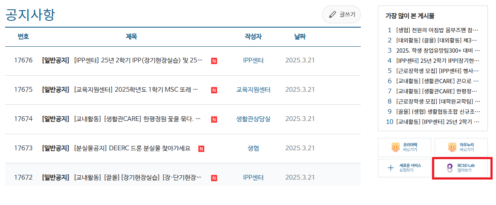

# 3-5. 공지사항_BCSD Lab 알아보기_클릭

[← 게시판 목록](README.md)

플랫폼: WEB  
원문 상태: 레거시  
[Notion 기준 명세](https://app.notion.com/p/3610221954bc8242806401ac4c10546b)  
원본 ID: `3610221954bc8242806401ac4c10546b`

<!-- notion-body:start -->
## 과거 로깅

- 설명: 공지사항 페이지 에서 BCSD Lab 알아보기 클릭
- event\_label : “short\_cut”
- value : “\{바로가기 타이틀\}”
- event\_category : “click”
- 참고사진



## 새 로깅 (레거시)
<!-- notion-body:end -->

<details>
<summary>Notion 원문 속성 전체</summary>

```json
{
  "platform": [
    "WEB"
  ],
  "url": "https://app.notion.com/p/3610221954bc8242806401ac4c10546b",
  "상태": "레거시",
  "이름": "3-5. 공지사항\\_BCSD Lab 알아보기\\_클릭",
  "태그": [
    "3. 공지사항 상세 페이지"
  ]
}
```

</details>
