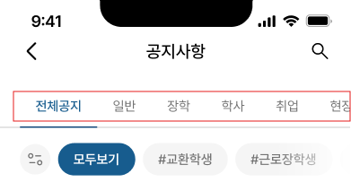
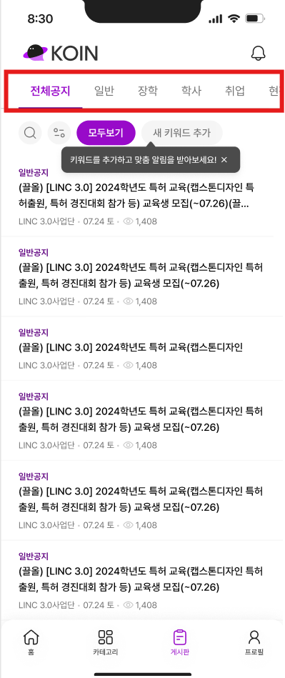

# 4-1. 탭 메뉴바_클릭

[← 게시판 목록](README.md)

플랫폼: ANDROID, IOS  
원문 상태: 로깅 필요  
[Notion 기준 명세](https://app.notion.com/p/8f30221954bc8267912a8138c434e100)  
원본 ID: `8f30221954bc8267912a8138c434e100`

<!-- notion-body:start -->
## 과거 로깅


각 탭 명을 value값으로 추가

- event\_label : ‘notice\_tab’
- value : 각 탭 명
- event\_category : ‘click’
- 설명 : 상단의 표시된 탭 클릭시 적용

## 새 로깅

- 설명: 공지사항 목록 상단의 탭 선택.
- screen\_view: <code>main_notice</code>
- event\_name: <code>DA2</code>
- event\_label: <code>board__main_notice__filter__tab__select</code>
- value: \{선택한 탭명\}
- event\_category: <code>select</code>

<b>참고사진 · 모바일</b>

<b>모바일</b>


<!-- notion-body:end -->

<details>
<summary>Notion 원문 속성 전체</summary>

```json
{
  "platform": [
    "ANDROID",
    "IOS"
  ],
  "url": "https://app.notion.com/p/8f30221954bc8267912a8138c434e100",
  "상태": "로깅 필요",
  "이름": "4-1. 탭 메뉴바\\_클릭",
  "태그": [
    "4. 공지사항 상세 페이지(APP)"
  ]
}
```

</details>
