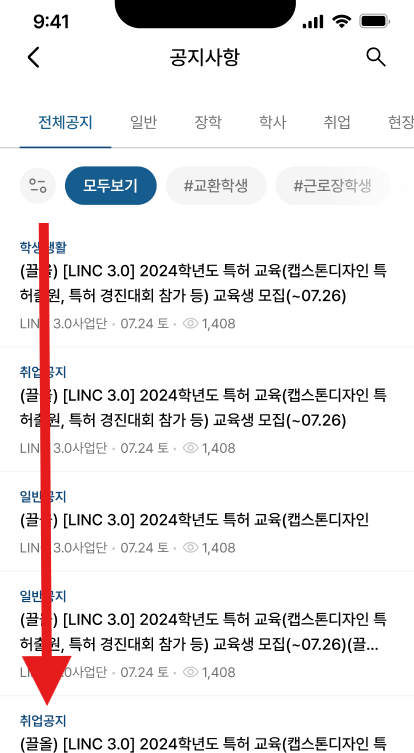
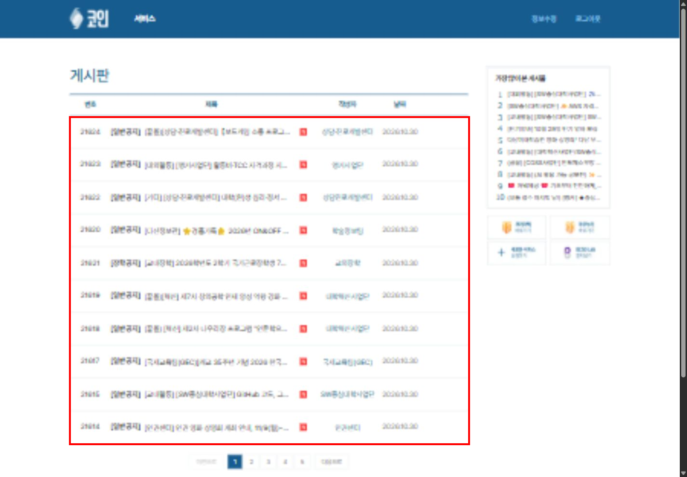
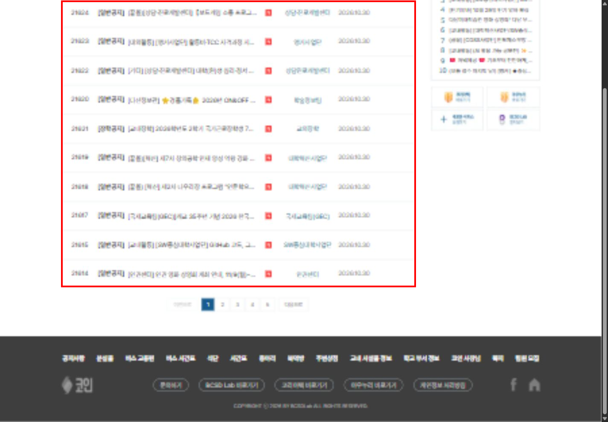
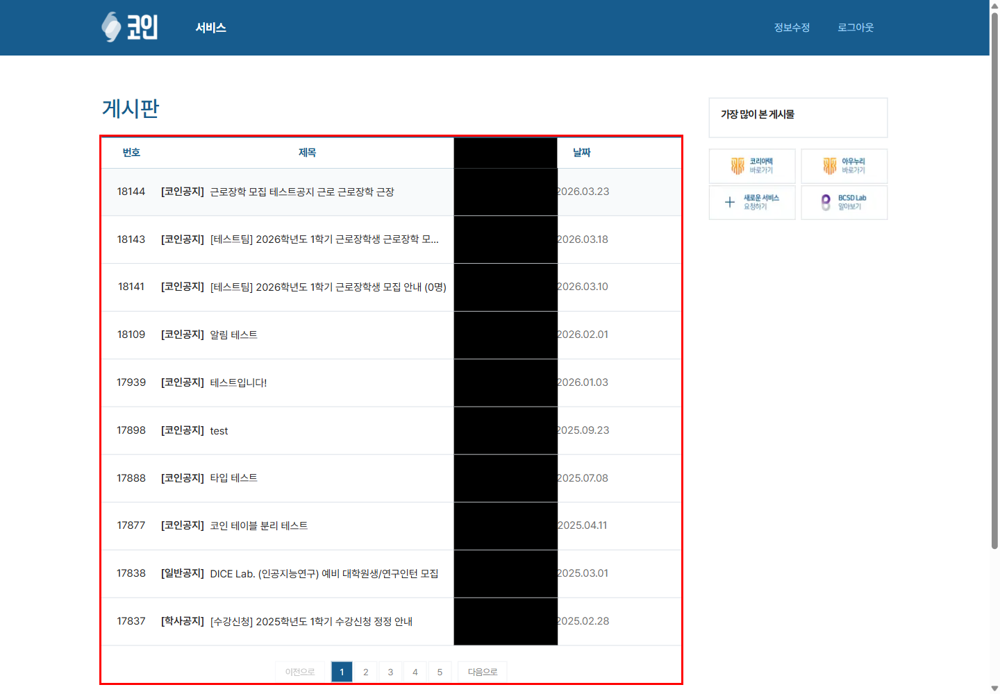
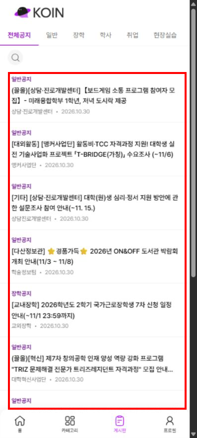
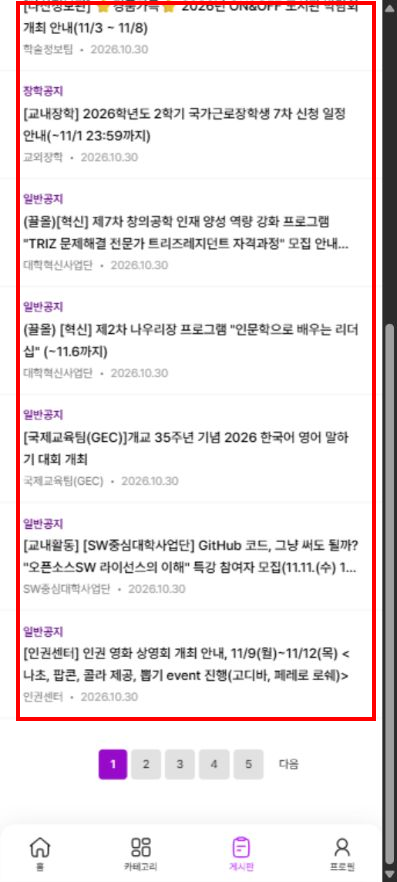
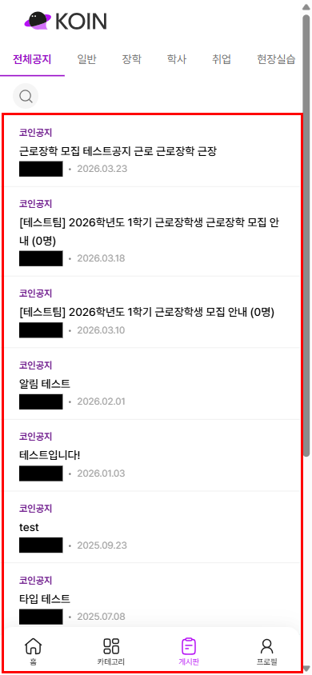
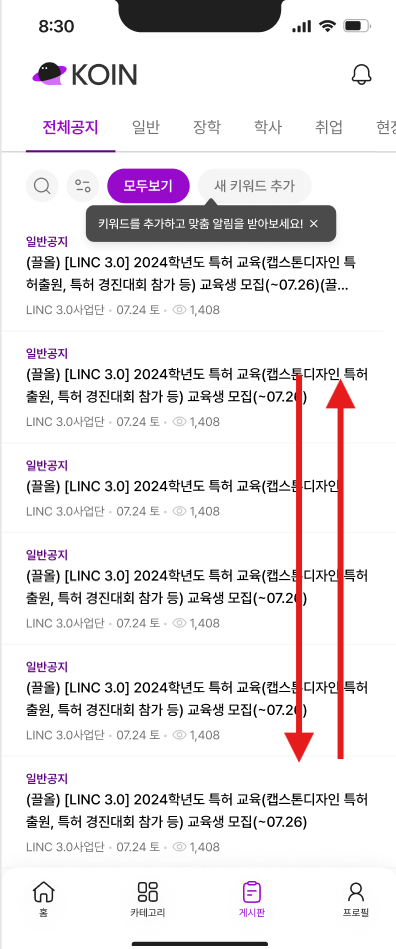

# 4-2. 공지사항 페이지_스크롤(상하)

[← 게시판 목록](README.md)

플랫폼: ANDROID, IOS, WEB, WEB (모바일)  
원문 상태: 로깅 필요  
[Notion 기준 명세](https://app.notion.com/p/28f0221954bc82099c08810da6e0fbb2)  
원본 ID: `28f0221954bc82099c08810da6e0fbb2`

<!-- notion-body:start -->
## 과거 로깅



## 새 로깅

- 설명: WEB·WEB (모바일)의 공지사항 목록에서 사용자 스크롤이 200ms 멈췄을 때 직전 정지 위치와 50 CSS px 이상 차이 나면 방향을 한 번 기록한다. 50px 미만 이동은 누적하지 않고 정지 기준점을 갱신한다. 최초 표시·위치 복원·자동 스크롤은 제외한다.
- screen\_view: <code>main_notice</code>
- event\_name: <code>DA2</code>
- event\_label: <code>board__main_notice__notice_list__scroll</code>
- value: 위로 또는 아래로
- event\_category: <code>scroll</code>

<b>스크롤 전후 · 운영 WEB (2026-10-30)</b>

출처: [koreatech.in](http://koreatech.in) 실제 공지사항 목록 화면. 빨간 테두리=목록 영역. 실제 스크롤 후 화면 위치를 비교하는 참고자료이며 SDK 이벤트 대상·발화·중복 전송은 미확인이다.


WEB · 스크롤 전 · 2026-10-30.


WEB · 스크롤 후 · 2026-10-30.

<b>참고사진 · 웹</b>


WEB · stage 실제 공지사항 목록 스크롤 영역. 작성자 정보는 검은색 마스킹. SDK 수집 근거와 구분. 2026-10-30.

<b>스크롤 전후 · 운영 모바일 웹 (2026-10-30)</b>

출처: [koreatech.in](http://koreatech.in) 실제 공지사항 목록 화면. 빨간 테두리=목록 영역. 실제 스크롤 후 화면 위치를 비교하는 참고자료이며 SDK 이벤트 대상·발화·중복 전송은 미확인이다. 네이티브 Android/iOS 앱 캡처와 구분한다.


모바일 웹 · 스크롤 전 · 2026-10-30.


모바일 웹 · 스크롤 후 · 2026-10-30.

<b>참고사진 · 모바일 웹</b>


모바일 웹 · stage 보라색 게시판 실제 목록. 작성자 정보 검은색 마스킹. 네이티브 앱과 구분. 2026-10-30.

<b>참고사진 · 모바일</b>

<b>모바일</b>


<!-- notion-body:end -->

<details>
<summary>Notion 원문 속성 전체</summary>

```json
{
  "platform": [
    "ANDROID",
    "IOS",
    "WEB",
    "WEB (모바일)"
  ],
  "url": "https://app.notion.com/p/28f0221954bc82099c08810da6e0fbb2",
  "상태": "로깅 필요",
  "이름": "4-2. 공지사항 페이지\\_스크롤(상하)",
  "태그": [
    "4. 공지사항 상세 페이지(APP)"
  ]
}
```

</details>
