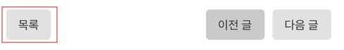
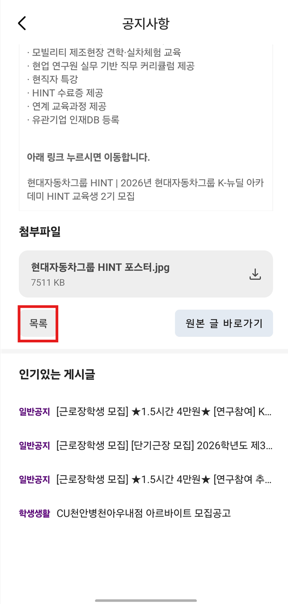

# 5-1. 목록_클릭

[← 게시판 목록](README.md)

플랫폼: ANDROID, IOS  
원문 상태: 로깅 필요  
[Notion 기준 명세](https://app.notion.com/p/b580221954bc833eba3b81e3778fea08)  
원본 ID: `b580221954bc833eba3b81e3778fea08`

<!-- notion-body:start -->
## 과거 로깅



## 새 로깅

- 설명: 공지 상세 화면의 목록 버튼을 눌러 공지사항 목록으로 돌아가기.
- screen\_view: <code>notice_detail</code>
- event\_name: <code>DA2</code>
- event\_label: <code>board__notice_detail__navigation__notice_list_return__click</code>
- value: 목록으로 돌아가기
- event\_category: <code>click</code>

<b>참고사진 · 모바일</b>

<b>모바일</b>


<!-- notion-body:end -->

<details>
<summary>Notion 원문 속성 전체</summary>

```json
{
  "platform": [
    "ANDROID",
    "IOS"
  ],
  "url": "https://app.notion.com/p/b580221954bc833eba3b81e3778fea08",
  "상태": "로깅 필요",
  "이름": "5-1. 목록\\_클릭",
  "태그": [
    "5. 공지사항 내용(APP)"
  ]
}
```

</details>
