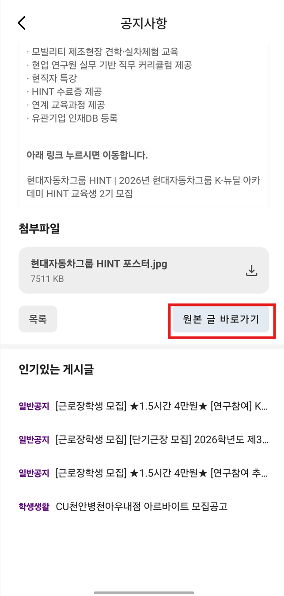

# 5-3. 공지 원본 바로가기_클릭

[← 게시판 로깅 목록](README.md)

플랫폼: ANDROID · IOS  
원문 상태: 로깅 필요

과거 로깅·새 로깅과 각 참고사진은 원문의 구간별 연결을 유지합니다.

<!-- logging-section:past:start -->
## 과거 로깅

- 설명 : 공지 상세페이지의 ‘바로가기’ 버튼들 로깅

- event\_label : “notice\_original\_shortcut”

- value : “<b>원본 글 바로가기”, “아우누리 바로가기”, “학생종합경력개발 바로가기”</b>

- event\_category : “click” 

- 참고사항

- 원본 글 바로가기 - <u>아래 탭들 + ‘코인’</u> 공지사항 제외 나머지 공지사항들
- 아우누리 바로가기 - ‘현장실습’, ‘학생생활’ 탭 공지사항들
- 학생종합경력개발 바로가기 - ‘취업’ 탭 공지사항들

<!-- logging-section:past:end -->

<!-- logging-section:new:start -->
## 새 로깅

- 설명: 공지 상세 화면에서 외부 원본 또는 관련 사이트 바로가기 클릭.
- screen\_view: <code>notice_detail</code>
- event\_name: <code>DA2</code>
- event\_label: <code>board__notice_detail__external_link__original_entry__click</code>
- value: 원본 글 바로가기 또는 아우누리 바로가기 또는 학생종합경력개발 바로가기
- event\_category: <code>click</code>

<b>모바일</b>

<!-- logging-section:new:end -->

---

원문 정보

원본 ID: `f670221954bc83c085d78119d5417ee6`  
[보존 원문](../../_archive/original/notion/pages/f670221954bc83c085d78119d5417ee6.md)

