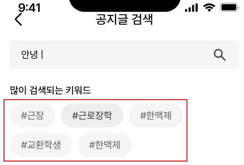
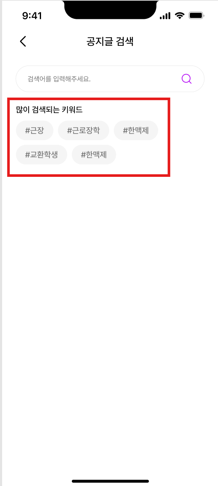

# 6-2. 많이 검색되는 키워드_클릭

[← 게시판 목록](README.md)

플랫폼: ANDROID, IOS  
원문 상태: 로깅 필요  
[Notion 기준 명세](https://app.notion.com/p/4f30221954bc82cc840681f7dcbc0155)  
원본 ID: `4f30221954bc82cc840681f7dcbc0155`

<!-- notion-body:start -->
## 과거 로깅


키워드를 value값으로 추가

## 새 로깅

- 설명: 공지글 검색 화면에서 많이 검색되는 키워드 선택.
- screen\_view: <code>notice_search</code>
- event\_name: <code>DA2</code>
- event\_label: <code>board__notice_search__search__popular_keyword__select</code>
- value: \{선택한 키워드\}
- event\_category: <code>select</code>

<b>참고사진 · 모바일</b>

<b>모바일</b>


<!-- notion-body:end -->

<details>
<summary>Notion 원문 속성 전체</summary>

```json
{
  "platform": [
    "ANDROID",
    "IOS"
  ],
  "url": "https://app.notion.com/p/4f30221954bc82cc840681f7dcbc0155",
  "상태": "로깅 필요",
  "이름": "6-2. 많이 검색되는 키워드\\_클릭",
  "태그": [
    "6. 공지글 검색(APP)"
  ]
}
```

</details>
