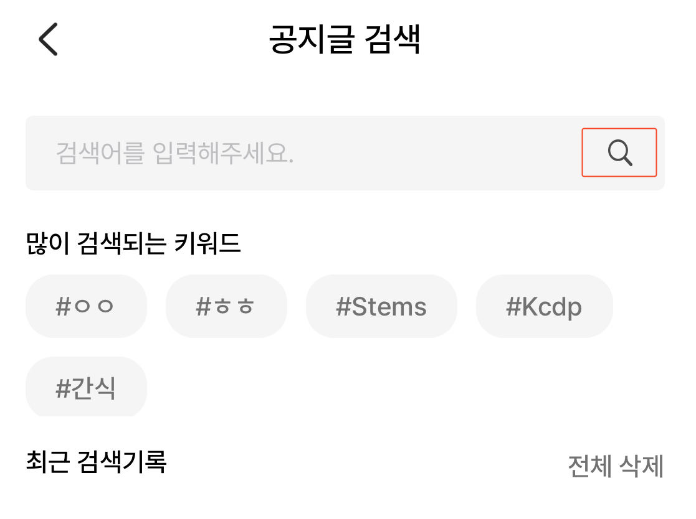
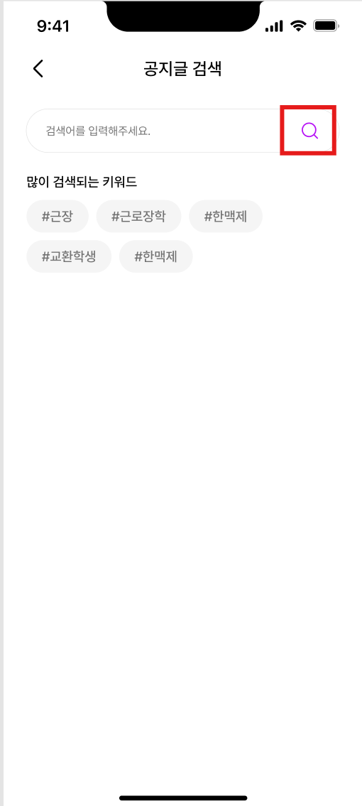

# 6-3. 공지글 검색_검색하기_클릭

[← 게시판 로깅 목록](README.md)

플랫폼: ANDROID · IOS  
원문 상태: 로깅 필요

과거 로깅·새 로깅과 각 참고사진은 원문의 구간별 연결을 유지합니다.

<!-- logging-section:past:start -->
## 과거 로깅

- 설명 : 공지글 검색 페이지에서 <u>최종 검색 버튼 클릭</u>

- 주의사항 : Enter, 돋보기 버튼 모두 로깅

- event\_label : “notice\_search\_event”

- value : “검색하기”

- event\_category : “click” 

<!-- logging-section:past:end -->

<!-- logging-section:new:start -->
## 새 로깅

- 설명: 공지글 검색 화면에서 최종 검색 실행.
- screen\_view: <code>notice_search</code>
- event\_name: <code>DA2</code>
- event\_label: <code>board__notice_search__search__submit</code>
- value: \{입력값\}
- event\_category: <code>submit</code>

<b>모바일</b>

<!-- logging-section:new:end -->

---

원문 정보

원본 ID: `82b0221954bc8273abbe81b4fc39095e`  
[보존 원문](../../_archive/original/notion/pages/82b0221954bc8273abbe81b4fc39095e.md)

