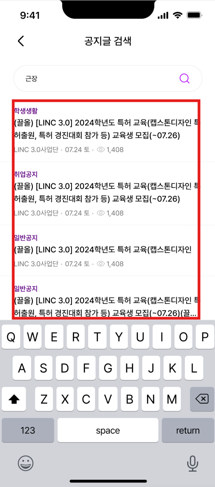

# 6-4. 공지글 검색_공지상세_클릭

[← 게시판 로깅 목록](README.md)

플랫폼: ANDROID · IOS  
원문 상태: 로깅 필요

과거 로깅·새 로깅과 각 참고사진은 원문의 구간별 연결을 유지합니다.

<!-- logging-section:past:start -->
## 과거 로깅

이전 로깅 없음

<!-- logging-section:past:end -->

<!-- logging-section:new:start -->
## 새 로깅

- 설명: 공지글 검색 화면에서 검색된 공지 클릭
- screen\_view: <code>notice_search</code>
- event\_name: <code>DA2</code>
- event\_label: <code>board__notice_search__notice_detail__entry__click</code>
- value: \{공지 ID\}
  - 이것도 안되면 공지 제목으로 대체해주세요
- event\_category: <code>click</code>

<b>참고사진 · 모바일</b>

<b>모바일</b>

<!-- logging-section:new:end -->

---

원문 정보

원본 ID: `eb70221954bc820fbd3a01ef13a803de`  
[보존 원문](../../_archive/original/notion/pages/eb70221954bc820fbd3a01ef13a803de.md)

