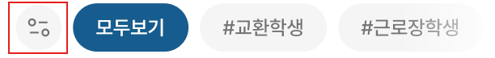
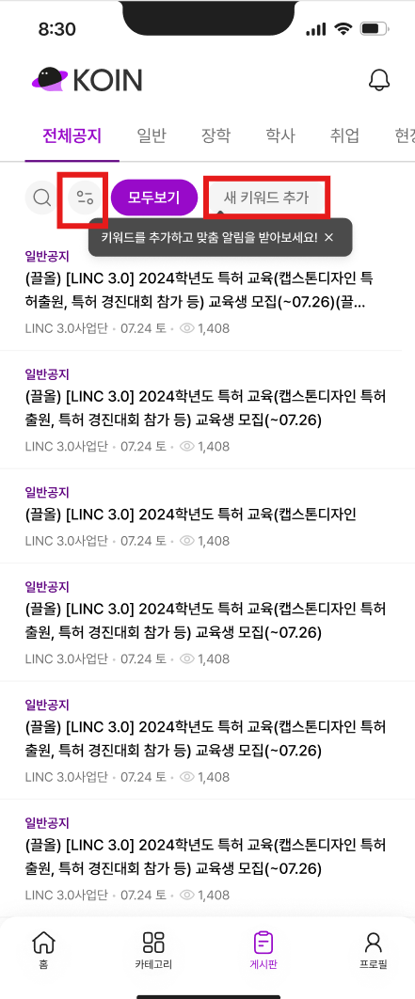

# 7-1. 키워드 관리_클릭

[← 게시판 로깅 목록](README.md)

플랫폼: ANDROID · IOS  
원문 상태: 로깅 필요

과거 로깅·새 로깅과 각 참고사진은 원문의 구간별 연결을 유지합니다.

<!-- logging-section:past:start -->
## 과거 로깅

<!-- logging-section:past:end -->

<!-- logging-section:new:start -->
## 새 로깅

- 설명: 공지사항 목록의 키워드 관리 아이콘을 눌러 관리 화면 진입.
- screen\_view: <code>main_notice</code>
- event\_name: <code>DA2</code>
- event\_label: <code>board__main_notice__keyword_manage__entry__click</code>
- value: 설정 아이콘 or 새 키워드 추가
  - 클릭하는 진입점에 따라 달리 해주세요
- event\_category: <code>click</code>

<b>모바일</b>

<!-- logging-section:new:end -->

---

원문 정보

원본 ID: `fc10221954bc83ae903381da469052e9`  
[보존 원문](../../_archive/original/notion/pages/fc10221954bc83ae903381da469052e9.md)

