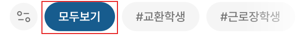
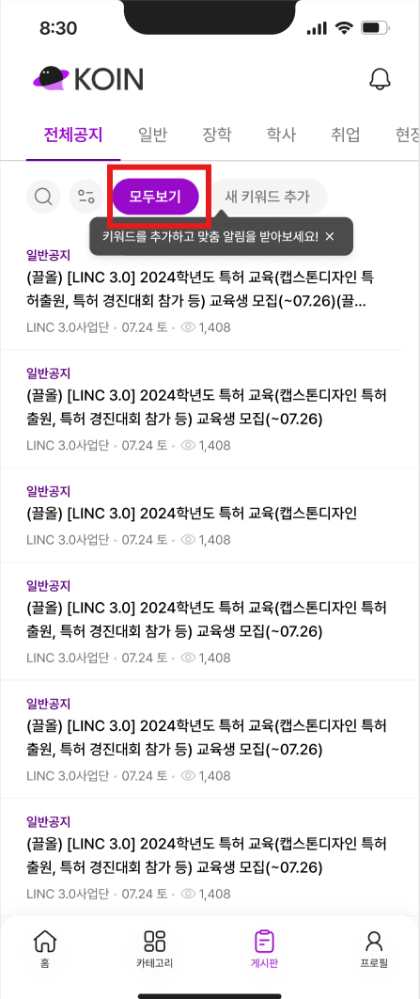

# 7-2. 모두 보기_클릭

[← 게시판 목록](README.md)

플랫폼: ANDROID, IOS  
원문 상태: 로깅 필요  
[Notion 기준 명세](https://app.notion.com/p/6a20221954bc824bb72c8128dde1af77)  
원본 ID: `6a20221954bc824bb72c8128dde1af77`

<!-- notion-body:start -->
## 과거 로깅



## 새 로깅

- 설명: 공지사항 목록의 모두보기 필터 선택.
- screen\_view: <code>main_notice</code>
- event\_name: <code>DA2</code>
- event\_label: <code>board__main_notice__filter__keyword__select</code>
- value: 모두보기
- event\_category: <code>select</code>

<b>참고사진 · 모바일</b>

<b>모바일</b>


<!-- notion-body:end -->

<details>
<summary>Notion 원문 속성 전체</summary>

```json
{
  "platform": [
    "ANDROID",
    "IOS"
  ],
  "url": "https://app.notion.com/p/6a20221954bc824bb72c8128dde1af77",
  "상태": "로깅 필요",
  "이름": "7-2. 모두 보기\\_클릭",
  "태그": [
    "7. 키워드 관리(APP)"
  ]
}
```

</details>
