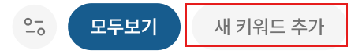

# 7-3. 새 키워드 추가_클릭

[← 게시판 로깅 목록](README.md)

플랫폼: ANDROID · IOS  
원문 상태: 레거시

과거 로깅·새 로깅과 각 참고사진은 원문의 구간별 연결을 유지합니다.

원문 미기재 항목: `screen_view`. 값을 추정하지 않았습니다.

<!-- logging-section:past:start -->
## 과거 로깅

<!-- logging-section:past:end -->

<!-- logging-section:new:start -->
## 새 로깅

- 설명: 공지사항 목록의 새 키워드 추가 버튼 클릭.
- screen\_view:
- event\_name: <code>DA2</code>
- event\_label: <code>board__notice_list__keyword_manage__add_entry</code>
- value: “새 키워드 추가”
- event\_category: <code>click</code>
- 적용 플랫폼: ANDROID, IOS
- 참고사항
  - 관리 화면 진입을 기록하는 항목이며, 키워드 입력값의 실제 저장은 7-4와 구분합니다.
- 참고사진: 이전 로깅의 참고사진 참조

<!-- logging-section:new:end -->

---

원문 정보

원본 ID: `a510221954bc8243963c01d45432380b`  
[보존 원문](../../_archive/original/notion/pages/a510221954bc8243963c01d45432380b.md)

