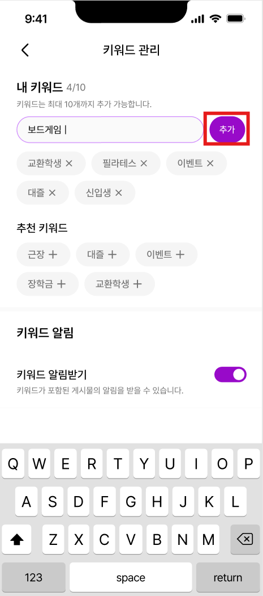

# 7-3. 키워드_추가_클릭

[← 게시판 로깅 목록](README.md)

플랫폼: ANDROID · IOS  
원문 상태: 로깅 필요

과거 로깅·새 로깅과 각 참고사진은 원문의 구간별 연결을 유지합니다.

<!-- logging-section:past:start -->
## 과거 로깅

이전 로깅 없음 

<!-- logging-section:past:end -->

<!-- logging-section:new:start -->
## 새 로깅

- 설명: 키워드 관리에서 내 키워드를 입력하고 추가 버튼을 클릭했을 때 발생하는 이벤트 

- screen\_view: <code>notice_keyword_manage</code>

- event\_name: <code>DA2</code>

- event\_label: <code>board__notice_keyword_manage__keyword_manage__add__submit</code>

- value: \{입력한 키워드\}

- event\_category: <code>submit</code>

<b>모바일</b>

<!-- logging-section:new:end -->

---

원문 정보

원본 ID: `4980221954bc8372bbc6015ff307fe49`  
[보존 원문](../../_archive/original/notion/pages/4980221954bc8372bbc6015ff307fe49.md)

