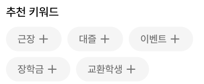
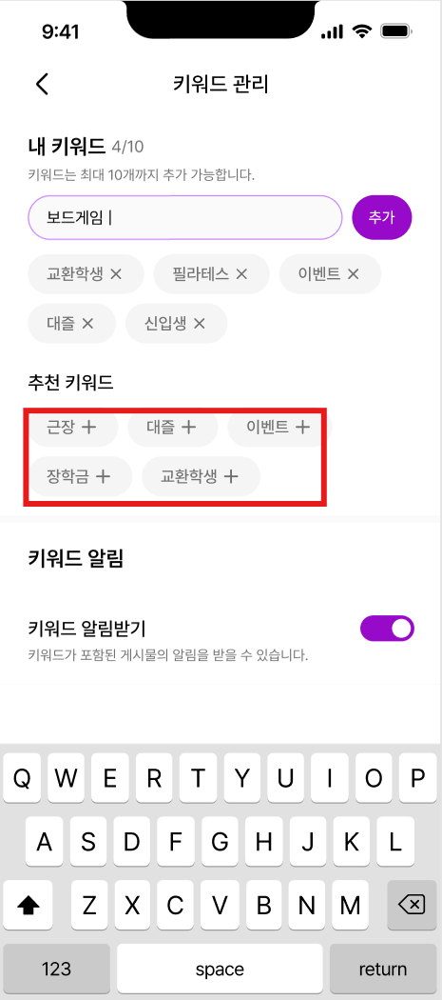

# 7-5. 추천 키워드_클릭

[← 게시판 로깅 목록](README.md)

플랫폼: ANDROID · IOS  
원문 상태: 로깅 필요

과거 로깅·새 로깅과 각 참고사진은 원문의 구간별 연결을 유지합니다.

<!-- logging-section:past:start -->
## 과거 로깅

키워드를 value값으로 추가

<!-- logging-section:past:end -->

<!-- logging-section:new:start -->
## 새 로깅

- 설명: 키워드 관리 화면에서 추천 키워드 선택.
- screen\_view: <code>notice_keyword_manage</code>
- event\_name: <code>DA2</code>
- event\_label: <code>board__notice_keyword_manage__keyword_manage__recommended_keyword__select</code>
- value: \{선택한 키워드\}
- event\_category: <code>select</code>

<b>모바일</b>

<!-- logging-section:new:end -->

---

원문 정보

원본 ID: `fda0221954bc8236ac64815e90e52edf`  
[보존 원문](../../_archive/original/notion/pages/fda0221954bc8236ac64815e90e52edf.md)

