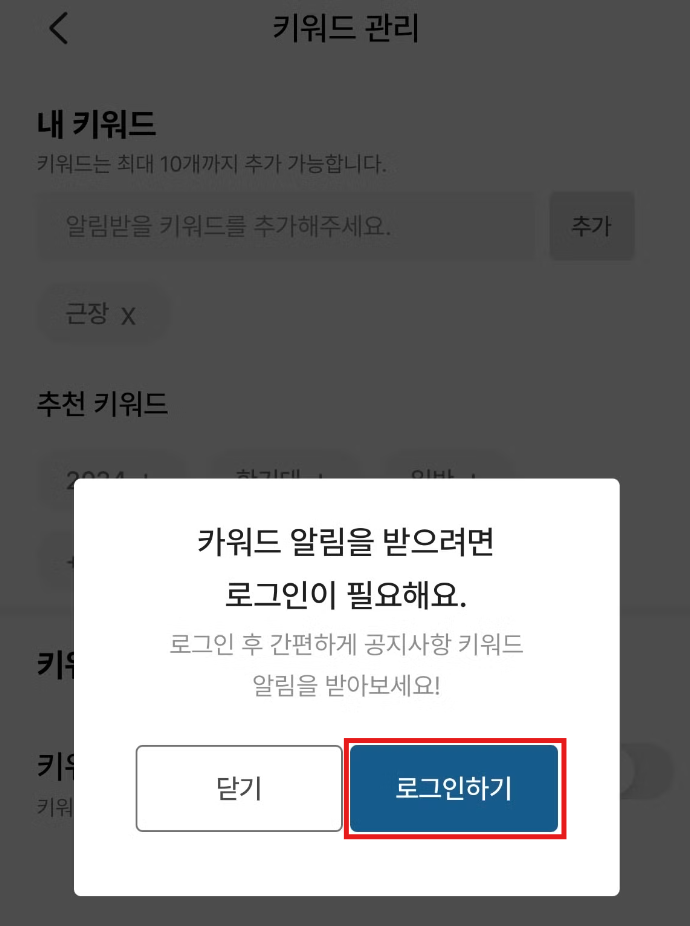

# 7-6. 로그인팝업_로그인하기_클릭

[← 게시판 목록](README.md)

플랫폼: ANDROID, IOS  
원문 상태: 로깅 필요  
[Notion 기준 명세](https://app.notion.com/p/ad60221954bc8310be78017b0e8f41d0)  
원본 ID: `ad60221954bc8310be78017b0e8f41d0`

<!-- notion-body:start -->
## 과거 로깅



## 새 로깅

- 설명: 키워드 관리 화면의 로그인 안내 팝업에서 로그인하기 버튼 클릭.
- screen\_view: <code>notice_keyword_manage</code>
- event\_name: <code>DA2</code>
- event\_label: <code>account__notice_keyword_manage__login_popup__login_entry__click</code>
- value: 로그인하기
- event\_category: <code>click</code>

<b>참고사진 · 모바일</b>

<b>모바일</b>

파란색 구버전 모바일 사진 제거 (2026-10-30).
<!-- notion-body:end -->

<details>
<summary>Notion 원문 속성 전체</summary>

```json
{
  "platform": [
    "ANDROID",
    "IOS"
  ],
  "url": "https://app.notion.com/p/ad60221954bc8310be78017b0e8f41d0",
  "상태": "로깅 필요",
  "이름": "7-6. 로그인팝업\\_로그인하기\\_클릭",
  "태그": [
    "7. 키워드 관리(APP)"
  ]
}
```

</details>
