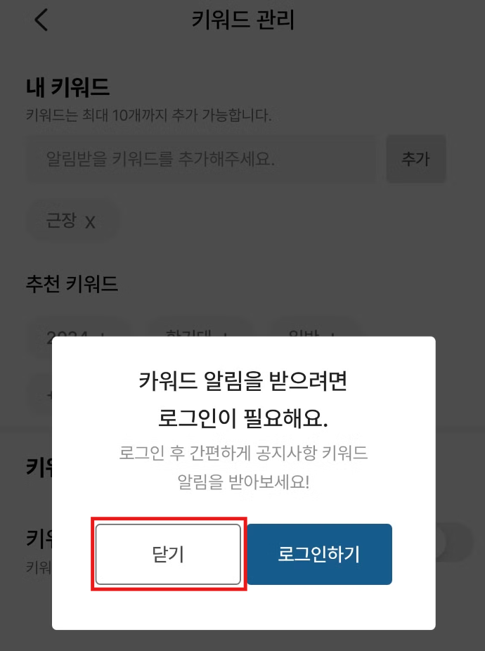

# 7-7. 로그인팝업_닫기_클릭

[← 게시판 로깅 목록](README.md)

플랫폼: ANDROID · IOS  
원문 상태: 로깅 필요

과거 로깅·새 로깅과 각 참고사진은 원문의 구간별 연결을 유지합니다.

<!-- logging-section:past:start -->
## 과거 로깅

<!-- logging-section:past:end -->

<!-- logging-section:new:start -->
## 새 로깅

- 설명: 키워드 관리 화면의 로그인 안내 팝업에서 닫기 버튼 클릭.
- screen\_view:<code>notice_keyword_manage</code>
- event\_name: <code>DA2</code>
- event\_label: <code>account__notice_keyword_manage__login_popup__close__click</code>
- value: 닫기
- event\_category: <code>click</code>

파란색 구버전 모바일 사진 제거 (2026-10-30).

<!-- logging-section:new:end -->

---

원문 정보

원본 ID: `c490221954bc83a4970701122aa95033`  
[보존 원문](../../_archive/original/notion/pages/c490221954bc83a4970701122aa95033.md)

