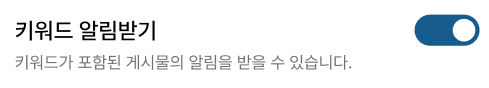
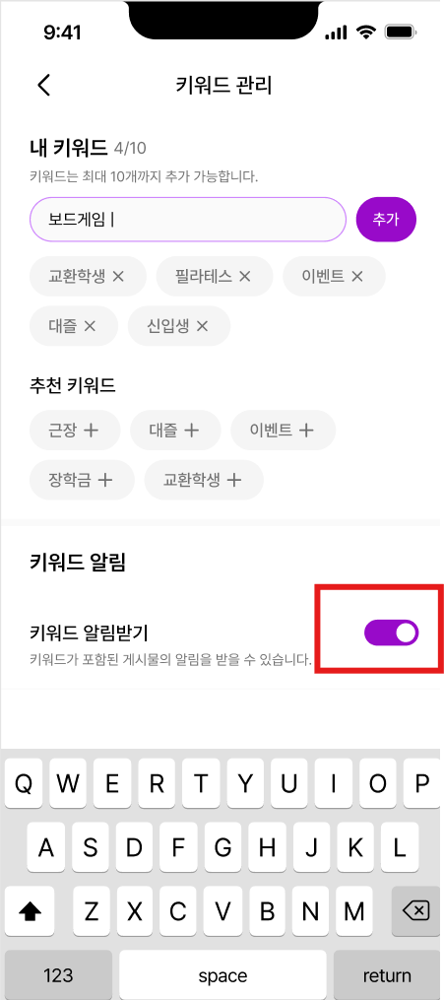

# 7-8. 키워드 알림받기_토글

[← 게시판 로깅 목록](README.md)

플랫폼: ANDROID · IOS  
원문 상태: 로깅 필요

과거 로깅·새 로깅과 각 참고사진은 원문의 구간별 연결을 유지합니다.

<!-- logging-section:past:start -->
## 과거 로깅

- 주의 사항 : <b>로그인 시</b>에만 ON 가능

<!-- logging-section:past:end -->

<!-- logging-section:new:start -->
## 새 로깅

- 설명: 키워드 관리 화면에서 키워드 알림받기 상태 변경.
- screen\_view:<code>notice_keyword_manage</code>
- event\_name: <code>DA2</code>
- event\_label: <code>board__notice_keyword_manage__keyword_manage__notification__toggle</code>
- value: 알림 켜기 또는 알림 끄기
- event\_category: <code>toggle</code>

<b>참고사진 · 모바일</b>

<b>모바일</b>

<!-- logging-section:new:end -->

---

원문 정보

원본 ID: `6980221954bc839e8d5581928e4ca5c0`  
[보존 원문](../../_archive/original/notion/pages/6980221954bc839e8d5581928e4ca5c0.md)

