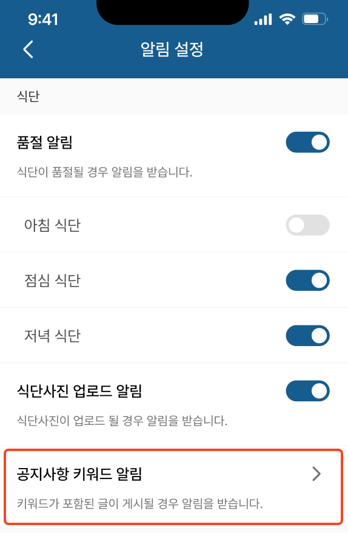

# 7-9. 알림설정_공지사항 키워드 알림_클릭

[← 게시판 목록](README.md)

플랫폼: ANDROID, IOS  
원문 상태: 로깅 필요  
[Notion 기준 명세](https://app.notion.com/p/6090221954bc8350ae8101d27555cf97)  
원본 ID: `6090221954bc8350ae8101d27555cf97`

<!-- notion-body:start -->
## 과거 로깅

- 설명 : <u>공지사항/키워드</u> 관리 페이지로 이동
- 주의사항 : 클릭 가능한 모든 요소(텍스트, 화살표) 로깅
- event\_label : “notification\_manage\_keyword”
- value : “공지사항 키워드 알림<b>”</b>
- event\_category : “click”
- 참고사진

  



## 새 로깅

- 설명: 알림 설정 화면에서 공지사항 키워드 알림 항목을 눌러 관리 화면 진입.
- screen\_view:<code>notification_config</code>
- event\_name: <code>DA2</code>
- event\_label: <code>board__notification_config__keyword_manage__entry__click</code>
- value: 공지사항 키워드 알림
- event\_category: <code>click</code>

<b>참고사진 · 모바일</b>

<b>모바일</b>

파란색 구버전 모바일 사진 제거 (2026-10-30).
<!-- notion-body:end -->

<details>
<summary>Notion 원문 속성 전체</summary>

```json
{
  "platform": [
    "ANDROID",
    "IOS"
  ],
  "url": "https://app.notion.com/p/6090221954bc8350ae8101d27555cf97",
  "상태": "로깅 필요",
  "이름": "7-9. 알림설정\\_공지사항 키워드 알림\\_클릭",
  "태그": [
    "7. 키워드 관리(APP)"
  ]
}
```

</details>
