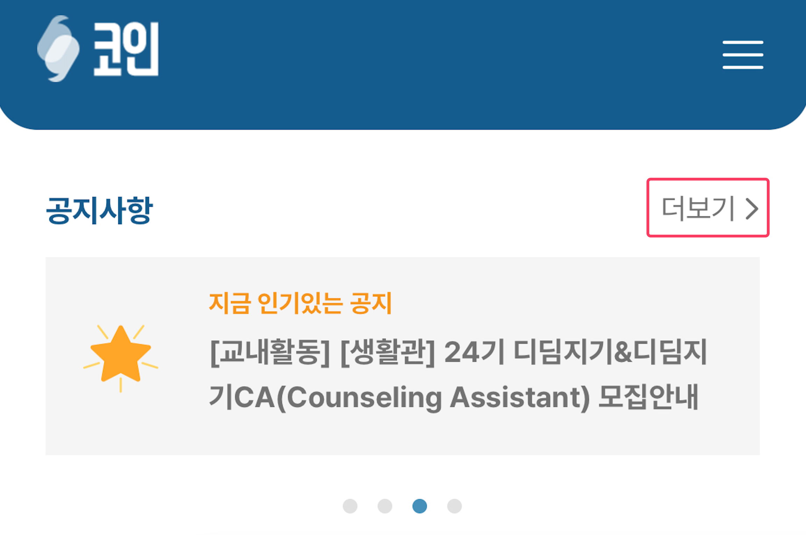

# 8-1. 더보기_클릭

[← 게시판 목록](README.md)

플랫폼: ANDROID, IOS  
원문 상태: 레거시  
[Notion 기준 명세](https://app.notion.com/p/39e0221954bc825a870101b32fcf2fe7)  
원본 ID: `39e0221954bc825a870101b32fcf2fe7`

<!-- notion-body:start -->
## 과거 로깅

- event\_label : “app\_main\_notice\_detail”
- value : “더보기<b>”</b>
- event\_category : “click”
- 참고사진

  



## 새 로깅

- 설명: 앱 메인 화면의 공지사항 더보기 클릭.
- screen\_view:
- event\_name: <code>DA2</code>
- event\_label: <code>board__main__notice__more_click</code>
- value: “공지사항 더보기”
- event\_category: <code>click</code>
- 적용 플랫폼: ANDROID, IOS
- 참고사항
  - WEB의 1-1과 같은 행동이므로 event\_label과 value를 공유하고 platform으로 구분합니다.
- 참고사진: 이전 로깅의 참고사진 참조
<!-- notion-body:end -->

<details>
<summary>Notion 원문 속성 전체</summary>

```json
{
  "platform": [
    "ANDROID",
    "IOS"
  ],
  "url": "https://app.notion.com/p/39e0221954bc825a870101b32fcf2fe7",
  "상태": "레거시",
  "이름": "8-1. 더보기\\_클릭",
  "태그": [
    "8. 앱 메인(APP)"
  ]
}
```

</details>
