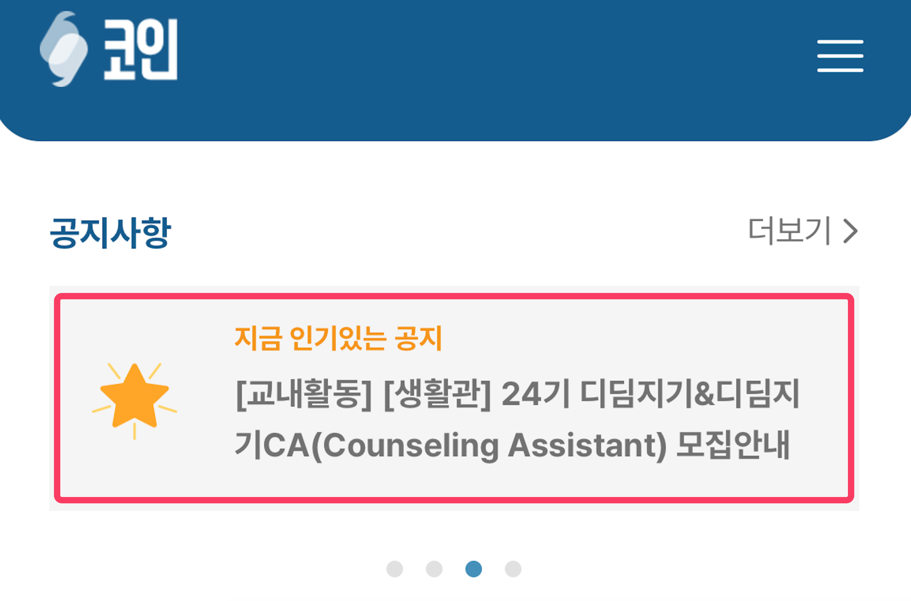

# 8-2. 지금 인기있는 공지 배너_클릭

[← 게시판 목록](README.md)

플랫폼: ANDROID, IOS  
원문 상태: 레거시  
[Notion 기준 명세](https://app.notion.com/p/cd30221954bc83b8b22b81648fd98eaf)  
원본 ID: `cd30221954bc83b8b22b81648fd98eaf`

<!-- notion-body:start -->
## 과거 로깅

- event\_label : “popular\_notice\_banne”
- value : “\{공지명\}<b>”</b>
- event\_category : “click”
- 참고사진

  



## 새 로깅

- 설명: 앱 메인 화면의 지금 인기있는 공지 배너 클릭.
- screen\_view:
- event\_name: <code>DA2</code>
- event\_label: <code>board__main__popular_notice__click</code>
- value: “\{공지명\}”
- event\_category: <code>click</code>
- 적용 플랫폼: ANDROID, IOS
- 참고사항
  - 클릭한 공지의 제목을 value로 전달합니다. 기존 popular\_notice\_banne 라벨을 새 네이밍으로 정리합니다.
- 참고사진: 이전 로깅의 참고사진 참조
<!-- notion-body:end -->

<details>
<summary>Notion 원문 속성 전체</summary>

```json
{
  "platform": [
    "ANDROID",
    "IOS"
  ],
  "url": "https://app.notion.com/p/cd30221954bc83b8b22b81648fd98eaf",
  "상태": "레거시",
  "이름": "8-2. 지금 인기있는 공지 배너\\_클릭",
  "태그": [
    "8. 앱 메인(APP)"
  ]
}
```

</details>
