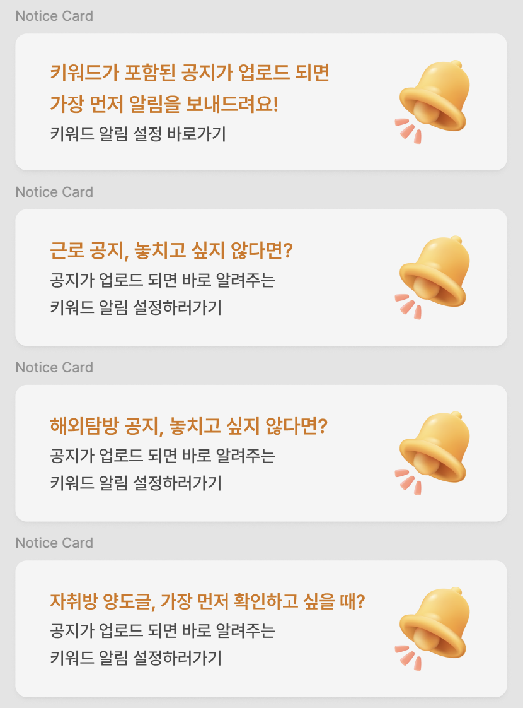

# 8-3. 키워드 관리 진입 배너_클릭

[← 게시판 목록](README.md)

플랫폼: ANDROID, IOS  
원문 상태: 레거시  
[Notion 기준 명세](https://app.notion.com/p/cfd0221954bc82d7913c01d7e9442395)  
원본 ID: `cfd0221954bc82d7913c01d7e9442395`

<!-- notion-body:start -->
## 과거 로깅

- 설명 : 메인 배너에서 키워드 알림설정 바로가기 (A/B테스트용)

  - 첫 배너에서 사용자당 업데이트 후 7일마다 변경됨
- event\_label : “to\_manage\_keyword”
- value : “안내글”<b>, “근로”, “해외탐방”, “자취방 양도”</b>
- event\_category : “click”
- 참고사진

  



## 새 로깅

- 설명: 앱 메인 배너에서 키워드 알림 설정 바로가기 클릭.
- screen\_view:
- event\_name: <code>DA2</code>
- event\_label: <code>board__main__keyword_manage__banner_entry</code>
- value: “안내글” 또는 “근로” 또는 “해외탐방” 또는 “자취방 양도”
- event\_category: <code>click</code>
- 적용 플랫폼: ANDROID, IOS
- 참고사항
  - 기존 A/B 테스트용 배너 유형 구분과 사용자당 업데이트 후 7일마다 변경된다는 조건을 보존합니다. 현재 배너 노출 방식을 확인합니다.
  - value에는 클릭한 배너의 유형을 전달합니다.
- 참고사진: 이전 로깅의 참고사진 참조
<!-- notion-body:end -->

<details>
<summary>Notion 원문 속성 전체</summary>

```json
{
  "platform": [
    "ANDROID",
    "IOS"
  ],
  "url": "https://app.notion.com/p/cfd0221954bc82d7913c01d7e9442395",
  "상태": "레거시",
  "이름": "8-3. 키워드 관리 진입 배너\\_클릭",
  "태그": [
    "8. 앱 메인(APP)"
  ]
}
```

</details>
