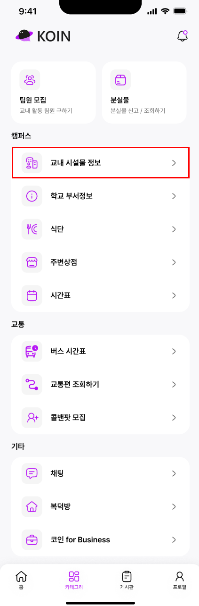

# [레거시] 10-3. 카테고리_교내 시설물 정보_클릭

[← 게시판 목록](README.md)

플랫폼: ANDROID, IOS  
원문 상태: 레거시  
[Notion 기준 명세](https://app.notion.com/p/fc20221954bc83e4b00b81ddea5deb74)  
원본 ID: `fc20221954bc83e4b00b81ddea5deb74`

<!-- notion-body:start -->
## 과거 로깅

- 설명: 햄버거에서 교내 시설물 정보 클릭
- event\_label : “hamburger”
- value : “교내 시설물 정보”
- event\_category : “click”
- 참고사진


- 설명: 메인 카테고리 화면에서 ‘교내 시설물 정보’를 클릭한다.
- screen\_view: <code>main_category</code>
- event\_label: <code>facility__main_category__facility_entry__category_entry__click</code>
- event\_name: <code>DA2</code>
- event\_category: <code>click</code>
- value: 교내 시설물 정보

### 참고사진 (기능 표시)

<b>참고사진 · 모바일</b>

화면 정의에 제공된 카테고리 캡처. 해당 메뉴의 위치에 빨간 테두리만 추가. 이번 작업의 실제 Android 신규 캡처가 아님.



## 새 로깅

레거시. [3-6 카테고리 내부 클릭 (현재 로깅) 2026.08.30 이후 찍히는 로깅](https://app.notion.com/p/ea70221954bc837d824b81d034d72403)를 따른다.
<!-- notion-body:end -->

<details>
<summary>Notion 원문 속성 전체</summary>

```json
{
  "platform": [
    "ANDROID",
    "IOS"
  ],
  "url": "https://app.notion.com/p/fc20221954bc83e4b00b81ddea5deb74",
  "상태": "레거시",
  "이름": "\\[레거시\\] 10-3. 카테고리\\_교내 시설물 정보\\_클릭",
  "태그": [
    "10. 헤더/푸터/햄버거_교내 시설물 정보"
  ]
}
```

</details>
