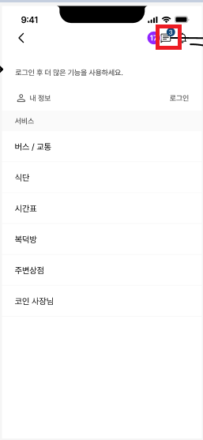
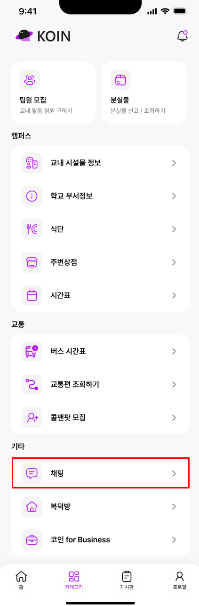

# [레거시] [레거시] 11-15.카테고리_채팅(쪽지)_클릭

> **레거시 문서** · 과거 구현과 로깅을 확인하기 위한 보존 자료입니다.

[← 게시판 로깅 목록](README.md)

플랫폼: ANDROID · IOS  
원문 상태: 레거시

과거 로깅·새 로깅과 각 참고사진은 원문의 구간별 연결을 유지합니다.

<!-- logging-section:past:start -->
## 과거 로깅

- 설명 : 햄버거 버튼을 누른 화면에서 쪽지 버튼 클릭

- event\_label : “hamburger”

- value : “쪽지<b>”</b>

- event\_category : “click” 

- 설명: 메인 카테고리 화면에서 ‘채팅’를 클릭한다.
- screen\_view: <code>main_category</code>
- event\_label: <code>chat__main_category__chat_entry__category_entry__click</code>
- event\_name: <code>DA2</code>
- event\_category: <code>click</code>
- value: 쪽지

### 참고사진 (기능 표시)

#### 모바일

화면 정의에 제공된 카테고리 캡처. 해당 메뉴의 위치에 빨간 테두리만 추가. 이번 작업의 실제 Android 신규 캡처가 아님.

<!-- logging-section:past:end -->

<!-- logging-section:new:start -->
## 새 로깅

레거시. [3-6 카테고리 내부 클릭 (현재 로깅) 2026.08.30 이후 찍히는 로깅](../10-%ED%99%88%ED%99%94%EB%A9%B4-%EB%A6%AC%EB%94%94%EC%9E%90%EC%9D%B8/3-6-%EC%B9%B4%ED%85%8C%EA%B3%A0%EB%A6%AC-%EB%82%B4%EB%B6%80-%ED%81%B4%EB%A6%AD-%28%ED%98%84%EC%9E%AC-%EB%A1%9C%EA%B9%85%29-2026.08.30-%EC%9D%B4%ED%9B%84-%EC%B0%8D%ED%9E%88%EB%8A%94-%EB%A1%9C%EA%B9%85.md)를 따른다.

<!-- logging-section:new:end -->

---

원문 정보

원본 ID: `0dc0221954bc8316be7a815e4460791f`  
[보존 원문](../../_archive/original/notion/pages/0dc0221954bc8316be7a815e4460791f.md)

