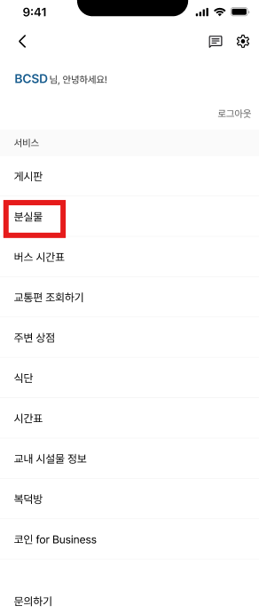
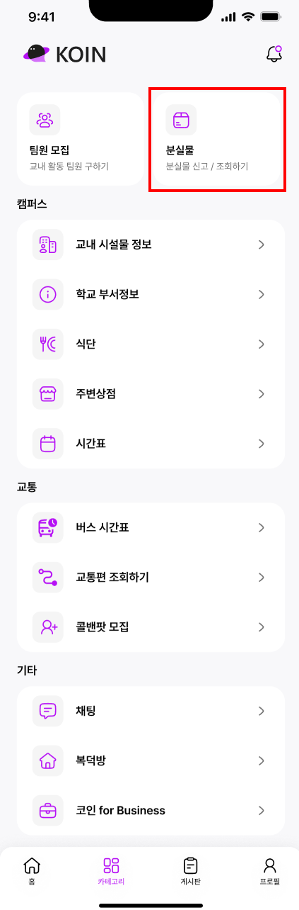

# [레거시·중복 원문] 11-21. 카테고리_분실물_클릭

[← 게시판 로깅 목록](README.md)

플랫폼: ANDROID · IOS  
원문 상태: 완료

과거 로깅·새 로깅과 각 참고사진은 원문의 구간별 연결을 유지합니다.

<!-- logging-section:past:start -->
## 과거 로깅

- 설명: 햄버거 버튼을 누른 화면에서 분실물 버튼 클릭
- event\_label : hamburger
- value : 분실물
- event\_category : click
- 참고사진

- 설명: 메인 카테고리 화면에서 분실물 버튼을 클릭한다.
- screen\_view: <code>main_category</code>
- event\_name: <code>DA2</code>
- event\_label: <code>board__main_category__category_navigation__lost_item_entry__click</code>
- value: 분실물
- event\_category: <code>click</code>

### 참고사진 (기능 표시)

<b>웹</b>

이 항목은 모바일 메뉴 진입 로깅입니다.

<b>모바일</b>

<b>참고사진 · 모바일</b>

모바일 — 카테고리의 분실물 진입

<!-- logging-section:past:end -->

<!-- logging-section:new:start -->
## 새 로깅

레거시. [3-6 카테고리 내부 클릭 (현재 로깅) 2026.08.30 이후 찍히는 로깅](../10-%ED%99%88%ED%99%94%EB%A9%B4-%EB%A6%AC%EB%94%94%EC%9E%90%EC%9D%B8/3-6-%EC%B9%B4%ED%85%8C%EA%B3%A0%EB%A6%AC-%EB%82%B4%EB%B6%80-%ED%81%B4%EB%A6%AD-%28%ED%98%84%EC%9E%AC-%EB%A1%9C%EA%B9%85%29-2026.08.30-%EC%9D%B4%ED%9B%84-%EC%B0%8D%ED%9E%88%EB%8A%94-%EB%A1%9C%EA%B9%85.md)를 따른다.

<!-- logging-section:new:end -->

---

원문 정보

원본 ID: `8390221954bc82a5a5c7014619d27bad`  
[보존 원문](../../_archive/original/notion/pages/8390221954bc82a5a5c7014619d27bad.md)

